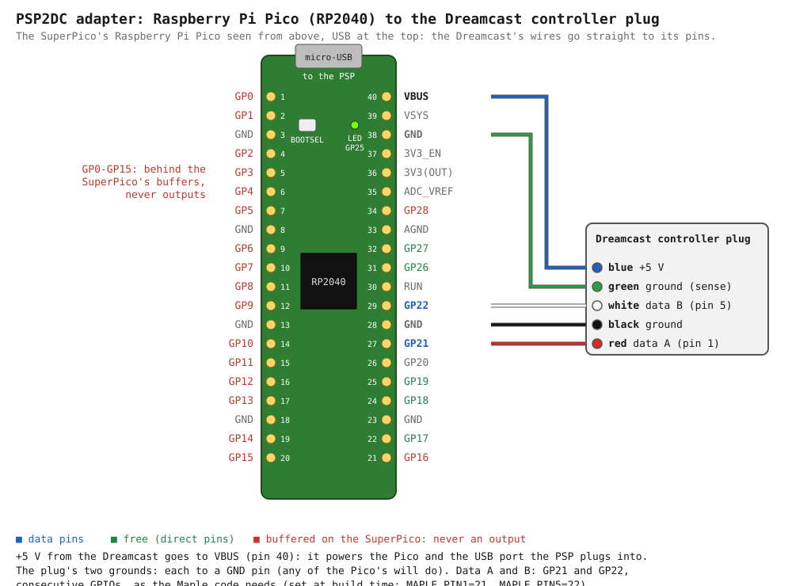

# PSP2DC

PSP2DC turns a Sony PSP-1000 into a Dreamcast controller and VMU. You play a
real Dreamcast with the PSP's buttons, and the VMU's screen is shown full size
on the PSP. The memory cards are files on the PSP's Memory Stick. With no
Dreamcast connected, the PSP works as a standalone VMU: clock, file manager,
and the VMU's own mini-games, buzzer included.

The PSP connects over USB to a small adapter, a
[Watara SuperPico](https://github.com/zwenergy/Superpico) cartridge (a
Raspberry Pi Pico, RP2040). The adapter runs a fork of
[joypad-os](https://github.com/joypad-ai/joypad-os) and talks to the
Dreamcast over the Maple bus.

```text
PSP-1000 (PSP2DC app)  --USB-->  SuperPico (joypad-os)  --Maple-->  Dreamcast
  buttons, nub  ------------------------------------------------->  controller
  VMU screen    <-------------------------------------------------  LCD writes
  memory cards  <------------------------------------------------>  card blocks
```

Nothing changes on the Dreamcast side: original console, original games.

## Status

Working on hardware:

- Controlling a real Dreamcast from the PSP.
- The VMU's live screen on the PSP.
- Memory cards kept on the Memory Stick; saves survive switching the console off.
- Changing cards while connected.
- The standalone VMU, including mini-games such as Chao Adventure 2.
- The RP2040-Zero adapter with the Dreamcast cable soldered on.

Not done yet:

- Latency measurements and broad game testing.
- Configurable button mapping.

The full design notes, test records and history are in
[docs/psp2dc.md](docs/psp2dc.md).

## What you need

| Part | Notes |
|---|---|
| PSP-1000 with custom firmware | Tested on 6.60 PRO-C. The USB driver is a kernel module. |
| Watara SuperPico | The adapter: a Raspberry Pi Pico (RP2040) on a cartridge board. |
| Dreamcast controller cable | Its five wires soldered to the Pico's pins (below). |
| Micro-USB OTG adapter + Mini-USB cable | Pico (USB host) to PSP (USB device). |
| 3.3 V USB-serial adapter | Optional: the firmware's debug log on GP20. |

### The adapter is an RP2040

The [SuperPico](https://github.com/zwenergy/Superpico) is a flash cartridge
for the Watara Supervision handheld. It is built around an ordinary Raspberry
Pi Pico, an RP2040 board, soldered onto the cartridge's circuit board. PSP2DC
uses only the Pico: the firmware runs on the RP2040, the PSP plugs into the
Pico's micro-USB port, and the Dreamcast cable is soldered straight to the
Pico's pins. Leave the cartridge out of the Supervision while it is the
adapter.



| Dreamcast wire | Colour | Pico pin |
|---|---|---|
| Data A (plug pin 1) | red | GP21, pin 27 |
| Data B (plug pin 5) | white | GP22, pin 29 |
| +5 V | blue | VBUS, pin 40 |
| Ground | black | GND, e.g. pin 28 |
| Sense (ground) | green | GND, e.g. pin 38 |
| *(optional)* debug log | | GP20, pin 26, to a USB-serial adapter's RX, 115200 8N1 |

The colours are those of Sega's own controller cable
([mc.pp.se](http://mc.pp.se/dc/controller.html)). Extension and third-party
cables can use other colours.

- **+5 V to VBUS:** the console's 5 V powers the Pico and, through VBUS, the
  USB port that the PSP plugs into.
- **Data A and B:** the Maple code needs two consecutive GPIOs. They are set
  at build time (`MAPLE_PIN1=21`, `MAPLE_PIN5=22`).

> **Warning:** on the SuperPico, three 74LVC245 buffers between the cartridge
> slot and the Pico are always on, and they always drive GP0–GP16 and GP28
> (red in the drawing). Firmware must never set those pins as outputs. Only
> GP17–GP22, GP26, GP27 and the LED (GP25) are free. See section 3.2 of the
> design notes.

### Or: a Waveshare RP2040-Zero

A smaller adapter: the [RP2040-Zero](https://www.waveshare.com/rp2040-zero.htm)
wired the same way as USB4Maple, which joypad-os already supports. It has no
buffers, so every pin is free. Works with PSP2DC.


| Dreamcast wire | Colour | RP2040-Zero pin |
|---|---|---|
| Data A (plug pin 1) | red | GP14 |
| Data B (plug pin 5) | white | GP15 |
| +5 V | blue | 5V |
| Ground, sense | black, green | GND (the one edge pin, or the GND pad underneath) |
| *(optional)* debug log | | GP0, to a USB-serial adapter's RX, 115200 8N1 |

- **5 V:** in Waveshare's schematic the 5V pin and the USB-C port's VBUS are
  one net, with no diode. The Dreamcast's 5 V therefore powers the board and
  the PSP's USB port. It also means you must never plug the USB-C into a
  computer while the Dreamcast powers the board: unplug the Dreamcast to
  flash it.
- **PSP cable:** a USB-C OTG adapter (USB-C plug to USB-A socket) and the
  usual USB-A to Mini-USB cable.
- **Firmware:** `scripts/build-firmware.sh rp2040zero`.

## Building

### PSP application

Needs the [pspdev](https://github.com/pspdev/pspdev) toolchain in `../pspdev`
(or set `PSPDEV=`). The script builds the kernel USB driver (`psp/usb`), the
boot module and the application.

```sh
scripts/build-psp.sh
```

The result is `dist/PSP2DC/`: `EBOOT.PBP`, `psp2dc_app.prx` and
`pspexp_usb.prx`. Copy it to `ms0:/PSP/GAME/PSP2DC/`.

### Adapter firmware

The firmware is not copied into this repository; it is kept as patches on
joypad-os. To set it up, see [firmware/README.md](firmware/README.md). It needs
the [Arm GNU toolchain](https://developer.arm.com/downloads/-/arm-gnu-toolchain-downloads)
(set `PICO_TOOLCHAIN_PATH` if it is not in the default place). Homebrew's
`arm-none-eabi-gcc` lacks newlib.

```sh
scripts/build-firmware.sh              # SuperPico: build/psp2dc_superpico_<time>.uf2
scripts/build-firmware.sh rp2040zero   # RP2040-Zero: build/psp2dc_rp2040zero_<time>.uf2
```

To flash, hold BOOTSEL while plugging the Pico into a computer, then copy the
`.uf2` file onto the drive that appears. Flashing replaces the SuperPico's own
firmware; back it up with `picotool` first if you want to keep it.

Always flash the newest file in `build/`, not one from joypad-os's
`releases/` folder. Its names carry the commit, so an older build there can
look like the new one.

## Using it

Start PSP2DC from the PSP's Game menu. It starts on the VMU tab, playing.

**SELECT switches between playing and the menu**, the same with or without a
Dreamcast:

- **Playing:** the VMU tab is shown and the buttons belong to the game. When
  connected, they are the Dreamcast pad: ✕ A, ○ B, □ X, △ Y, START, the d-pad,
  the nub as the stick, and L / R as the triggers. When standalone, they are
  the VMU's: the d-pad, ✕ A, ○ B, △ MODE and □ SLEEP. Hold △ for 2 s to leave
  a running VMU game.
- **Menu:** the header lights up and the buttons work PSP2DC. Nothing reaches
  the Dreamcast while the menu is open.

| Key (menu) | Action |
|---|---|
| L / R | Previous / next tab: VMU, Saves, Cards, System |
| ▲ / ▼ | Choose |
| ✕ | OK |
| ○ | Back |
| ◀ / ▶ | Change the theme (System tab) |
| △ | Screenshot to `ms0:/PSP2DC/shots/` |
| SELECT | Back to playing |

Anything that can't be done right now is greyed out. For example, while
connected the Dreamcast has the card, so only Info and *Use this card* remain.
Results show for a moment in the header.

To change the memory card, open the Cards tab, choose the card and pick *Use
this card*. *New card* is the tab's first row.

### A card per game (openMenu)

With GDEMU and openMenu, each game can get its own memory card
automatically. When openMenu starts a disc, it sends the game's ID to the
adapter, which passes it to the PSP. The PSP then puts in a card named after
the game's product number (for example `t-8101n`), creating it the first time.
In openMenu, set **VMU Game ID** to send. On the PSP, it is the **Card per
game** setting in System (on by default). Works on a Dreamcast with GDEMU
and openMenu.

### The keyboard

The PSP can also be a Dreamcast keyboard. Turn it on with **Keyboard** in System:

- **with the pad:** the controller and the keyboard together, the VMU still in. Untested with games.
- **keyboard only:** a keyboard alone, as Sega's: no pad, no VMU.

Then **START** in the menu opens the keyboard, and SELECT goes back to the menu.

| Key | Action |
|---|---|
| D-pad | Choose a key |
| ✕ | Press it (Shift, Ctrl, Alt: for the next key) |
| □ / △ / START / ○ | Backspace / Space / Enter / Esc |
| L | Shift, held |
| Nub | Arrow keys |

The layout is a US keyboard.

### Memory cards

Each card is a 128 KB image (the usual VMU dump) in `ms0:/PSP2DC/cards/`. Any
`NAME.bin` there is a card, so cards can be added from a computer. From the
Cards and Saves tabs (standalone; while connected most of this is greyed
out) you can:

- Make, rename, duplicate, delete, defragment, and check and repair a card.
- Copy, move, delete and import saves.
- Export saves as `.DCI` or `.VMS` with `.VMI`.

Backups are made automatically before anything removes data, into
`ms0:/PSP2DC/backups/`. When reconnecting, PSP2DC compares the adapter's copy
of the card with its own. If both changed, the adapter's copy goes to a new
card (`NAME-dc`) and nothing is written over.

With no PSP connected, the Dreamcast sees no memory card: the card lives on
the PSP.

## Repository layout

| Path | Contents |
|---|---|
| `psp/boot/` | Kernel boot module and EBOOT, which load the USB driver and the app |
| `psp/app/` | The application: UI, card handling, standalone VMU, VMU CPU core |
| `psp/usb/` | The kernel USB driver, copied from PSPExp |
| `protocol/psp2dc_protocol.h` | The USB message format, shared by the PSP and the firmware |
| `firmware/` | joypad-os patches for the `usb2dc_superpico` target |
| `scripts/` | Build scripts |
| `scripts/dev/` | PPSSPP runner, host tests for the card code, the VMU core comparison |
| `docs/psp2dc.md` | Design notes, hardware findings, test records |

## Development without hardware

In PPSSPP the USB driver cannot work, so PSP2DC starts in demo mode. Everything
but the Dreamcast link can be tried there.

- `scripts/dev/run-ppsspp.sh` installs `dist/PSP2DC` into PPSSPP and starts it.
- A file `ms0:/PSP2DC/dev_input.txt` holds a timed list of buttons for the
  app to play back (lines of `ms key[+key]`), so scripted runs can take
  screenshots.
- The card code has host tests (`scripts/dev/cardfs-test*.c`,
  `card-sync-test.c`).
- `scripts/dev/vmucore-compare/` runs the VMU core against libevmu and
  compares them frame by frame.

No game files or saves are included. The tests read your own files from
wherever you keep them.

## Credits and licences

- [joypad-os](https://github.com/joypad-ai/joypad-os) (Apache-2.0):
  the adapter firmware base.
- [MaplePad](https://github.com/mackieks/MaplePad) (CC BY 4.0): reference for
  the VMU screen handling.
- [libevmu / ElysianVMU](https://github.com/gyrovorbis/libevmu) (MIT): the
  source of `psp/app/vmu_core.c`, which carries its licence.
- PSPExp (MIT): the PSP's kernel USB driver in `psp/usb/`, copied unchanged.
  Its descriptors and driver start follow PSPLink's usbhostfs (BSD,
  `psp/usb/LICENSE.PSPLINK`).
- [Superpico](https://github.com/zwenergy/Superpico): the adapter hardware.

PSP2DC is released under the MIT licence: see [LICENSE](LICENSE). Files taken
from other projects keep their own licences, as listed above: the firmware
patches apply to joypad-os (Apache-2.0), `psp/app/vmu_core.c` carries
libevmu's MIT notice, and parts of `psp/usb/main.c` are under PSPLink's BSD
licence.
