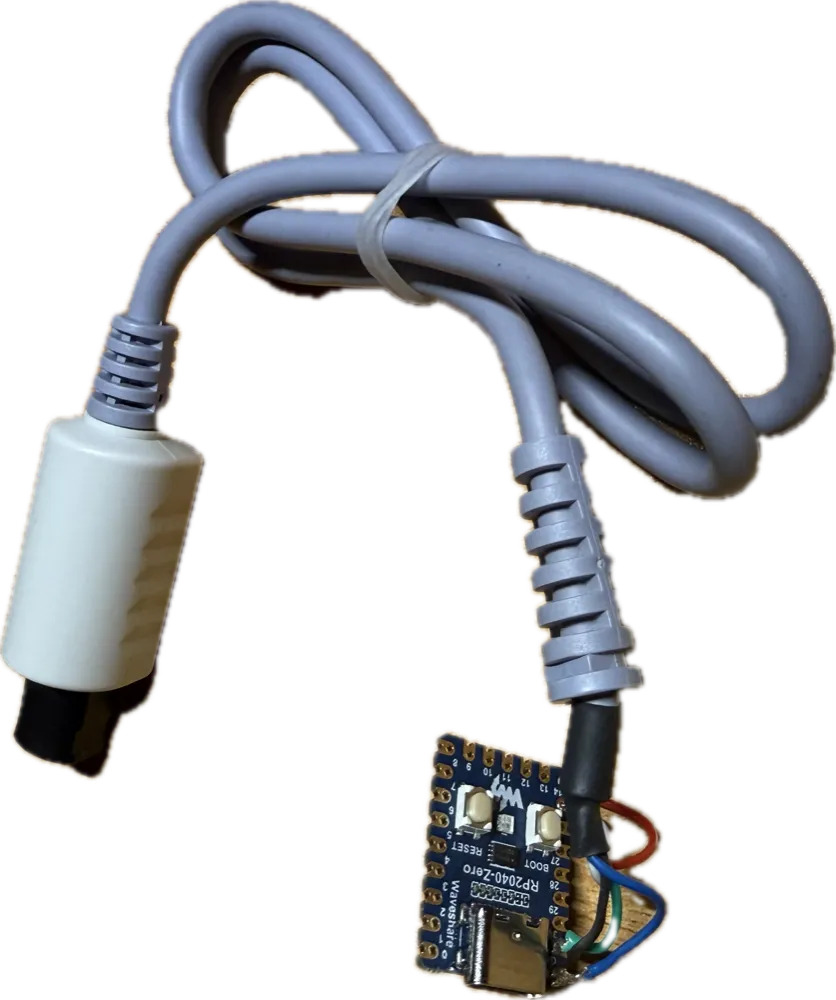
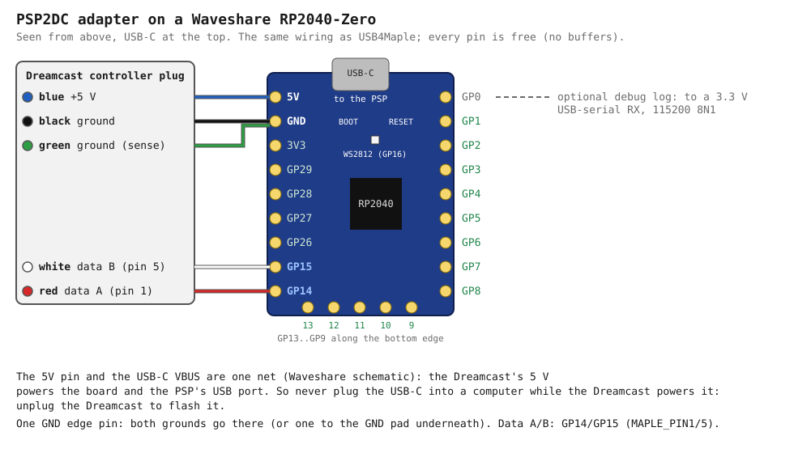

# PSP2DC

PSP2DC turns a Sony PSP-1000 into a Dreamcast controller and VMU. You play a
real Dreamcast with the PSP's buttons, and the VMU's screen is shown full size
on the PSP. The memory cards are files on the PSP's Memory Stick. The PSP can
also be a Dreamcast keyboard. With no Dreamcast connected, it works as a
standalone VMU: clock, file manager, and the VMU's own mini-games, buzzer
included.

The PSP connects over USB to a small adapter: a
[Waveshare RP2040-Zero](https://www.waveshare.com/rp2040-zero.htm), an RP2040
board, with a Dreamcast controller cable soldered to it. The adapter runs a fork of
[joypad-os](https://github.com/joypad-ai/joypad-os) and talks to the
Dreamcast over the Maple bus.

```text
PSP-1000 (PSP2DC app)  --USB-->  RP2040-Zero (joypad-os)  --Maple-->  Dreamcast
  buttons, nub  ------------------------------------------------->  controller
  VMU screen    <-------------------------------------------------  LCD writes
  memory cards  <------------------------------------------------>  card blocks
```

Nothing changes on the Dreamcast side: original console, original games.

## Status

Working on hardware:

- Controlling a real Dreamcast from the PSP.
- The VMU's live screen on the PSP.
- Memory cards kept on the Memory Stick; saves survive switching the console off.
- Changing cards while connected.
- A card per game, with GDEMU and openMenu.
- The Dreamcast keyboard, in openMenu and Typing of the Dead.
- The standalone VMU, including mini-games such as Chao Adventure 2.
- The RP2040-Zero adapter with the Dreamcast cable soldered on.

Not done yet:

- Latency measurements and broad game testing.

In progress: the **companion**, a way for Dreamcast homebrew (KallistiOS) to
use the PSP as a second screen. The proposal and what is built of it are in
[docs/psp2dc-companion.md](docs/psp2dc-companion.md): a program can put
widgets (labels, numbers, bars, lists) on the PSP, draw into regions of its
screen, send bitmaps and sprites, keep files on the PSP's Memory Stick, and
take some of the PSP's buttons for its own screen. It runs on a Dreamcast: 59
KB a second to the PSP without an error, files read back at 54 KB a second,
and the demo game's dashboard on the PSP. For developers:
[dreamcast/libpsp2dc/README.md](dreamcast/libpsp2dc/README.md), with three
small samples.

The full design notes, test records and history are in
[docs/psp2dc.md](docs/psp2dc.md).

## What you need

| Part | Notes |
|---|---|
| PSP-1000 with custom firmware | Tested on 6.60 PRO-C. The USB driver is a kernel module. |
| Waveshare RP2040-Zero | The adapter: a small RP2040 board with a USB-C port. |
| Dreamcast controller cable | Its five wires soldered to the board (below). |
| USB-C OTG adapter + Mini-USB cable | The board (USB host) to the PSP (USB device). |

### The adapter: an RP2040-Zero

The firmware runs on the board's RP2040, the PSP plugs into its USB-C port,
and the Dreamcast cable is soldered straight to its pins. It is wired the
same way as USB4Maple, which joypad-os already supports.





| Dreamcast wire | Colour | RP2040-Zero pin |
|---|---|---|
| Data A (plug pin 1) | red | GP14 |
| Data B (plug pin 5) | white | GP15 |
| +5 V | blue | 5V |
| Ground, sense | black, green | GND (the one edge pin, or the GND pad underneath) |

The colours are those of Sega's own controller cable
([mc.pp.se](http://mc.pp.se/dc/controller.html)). Extension and third-party
cables can use other colours.

- **5 V:** in Waveshare's schematic the 5V pin and the USB-C port's VBUS are
  one net, with no diode. The Dreamcast's 5 V therefore powers the board and
  the PSP's USB port. It also means you must never plug the USB-C into a
  computer while the Dreamcast powers the board: unplug the Dreamcast to
  flash it.
- **PSP cable:** a USB-C OTG adapter (USB-C plug to USB-A socket) and the
  usual USB-A to Mini-USB cable.
- **Diagnostics:** the firmware prints no debug log. The adapter's counters
  are on the PSP, in Settings → Details.

PSP2DC was prototyped on another RP2040 board, the Raspberry Pi Pico of a
Watara SuperPico cartridge. That adapter still works, and its wiring is in
[docs/superpico.md](docs/superpico.md).

## Installing a release

A release (the repository's Releases page) is one zip with everything built:

- `psp/`: copy its `PSP` folder onto the PSP's Memory Stick.
- `adapter/`: the RP2040-Zero's firmware. Hold BOOT while plugging the board
  into a computer and copy the `.uf2` onto the drive that appears.
- `dreamcast/`: disc images for homebrew developers (the companion's demo,
  its test, the library's samples).

The PSP application and the adapter's firmware must be of the same release.
`scripts/make-release.sh <version>` makes the zip from the sources.

## Building

### PSP application

Needs the [pspdev](https://github.com/pspdev/pspdev) toolchain in `../pspdev`
(or set `PSPDEV=`). The script builds the kernel USB driver (`psp/usb`), the
boot module and the application.

```sh
scripts/build-psp.sh
```

The result is `dist/PSP2DC/`: `EBOOT.PBP`, `psp2dc_app.prx` and
`pspexp_usb.prx`. Copy it to `ms0:/PSP/GAME/PSP2DC/`.

### Adapter firmware

The firmware is not copied into this repository; it is kept as patches on
joypad-os. To set it up, see [firmware/README.md](firmware/README.md). It needs
the [Arm GNU toolchain](https://developer.arm.com/downloads/-/arm-gnu-toolchain-downloads)
(set `PICO_TOOLCHAIN_PATH` if it is not in the default place). Homebrew's
`arm-none-eabi-gcc` lacks newlib.

```sh
scripts/build-firmware.sh   # build/psp2dc_rp2040zero_<time>.uf2
```

To flash, unplug the Dreamcast, hold the board's BOOT button while plugging
it into a computer, then copy the `.uf2` file onto the drive that appears.

Always flash the newest file in `build/`, not one from joypad-os's
`releases/` folder. Its names carry the commit, so an older build there can
look like the new one.

### The companion's Dreamcast programs

Needs Docker; the script uses the `kazade/dreamcast-sdk` image, which carries
KallistiOS and its compiler.

```sh
scripts/build-dreamcast.sh
```

The results are disc images for GDEMU: `build/psp2dc_test.cdi`, which
measures what the path carries, `build/psp2dc_demo.cdi`, a small game
with its dashboard on the PSP, and the library's samples in `build/samples/`
(hello, dashboard, save).

## Using it

Start PSP2DC from the PSP's Game menu. It starts playing, with the VMU on
screen.

**SELECT switches between playing and the menu**, the same with or without a
Dreamcast:

- **Playing:** the VMU is shown and the buttons belong to the game. When
  connected, they are the Dreamcast pad: ✕ A, ○ B, □ X, △ Y, START, the d-pad,
  the nub as the stick, and L / R as the triggers. When standalone, they are
  the VMU's: the d-pad, ✕ A, ○ B, △ MODE and □ SLEEP. Hold △ for 2 s to leave
  a running VMU game.
- **Menu:** the header lights up and the buttons work PSP2DC. The VMU stays
  on the left, and beside it a list: VMU (back to playing), Saves, Cards,
  Keyboard and Settings, each with a line on what is there. Saves, Cards and
  Settings open in the same place. Nothing reaches the Dreamcast while the
  menu is open.

| Key (menu) | Action |
|---|---|
| ▲ / ▼ | Choose |
| ✕ | Open, OK |
| ○ | Back (from the list: back to playing) |
| L / R | A page up / down in a long list |
| ◀ / ▶ | Change the theme (Settings) |
| △ | Screenshot to `ms0:/PSP2DC/shots/` |
| SELECT | Back to playing |

Anything that can't be done right now is greyed out. For example, while
connected the Dreamcast has the card, so only Info and *Use this card* remain.
A long name in the chosen row scrolls. Results show for a moment in the
middle of the screen. Settings → Keys lists every key.

To change the memory card, open Cards in the menu, choose the card and pick
*Use this card*. *New card* is the list's first row.

### A card per game (openMenu)

With GDEMU and openMenu, each game can get its own memory card
automatically. When openMenu starts a disc, it sends the game's ID to the
adapter, which passes it to the PSP. The PSP then puts in a card named after
the game's product number (for example `t-8101n`), creating it the first time.
When openMenu also sends the game's name, the PSP keeps it beside the card
(`t-8101n.txt`) and shows it on the Cards page.
In openMenu, set **VMU Game ID** to send. On the PSP, it is the **Card per
game** setting in Settings (on by default). Works on a Dreamcast with GDEMU
and openMenu.

### The keyboard

The PSP can also be a Dreamcast keyboard, for Typing of the Dead and the
like. Turn **Keyboard** on in the menu: the adapter is then a keyboard alone,
as Sega's, with no pad and no VMU. Playing is then typing, and SELECT
switches between the keyboard and the menu.

| Key | Action |
|---|---|
| D-pad | Choose a key |
| ✕ | Press it (Shift, Ctrl, Alt: for the next key) |
| □ / △ / START / ○ | Backspace / Space / Enter / Esc |
| L | Shift, held |
| Nub | Arrow keys |

The layout is a US keyboard. Works in openMenu and Typing of the Dead.

### Memory cards

Each card is a 128 KB image (the usual VMU dump) in `ms0:/PSP2DC/cards/`. Any
`NAME.bin` there is a card, so cards can be added from a computer. From the
Cards and Saves pages (standalone; while connected most of this is greyed
out) you can:

- Make, rename, duplicate, delete, defragment, and check and repair a card.
- Copy, move, delete and import saves.
- Export saves as `.DCI` or `.VMS` with `.VMI`.

Backups are made automatically before anything removes data, into
`ms0:/PSP2DC/backups/`. When reconnecting, PSP2DC compares the adapter's copy
of the card with its own. If both changed, the adapter's copy goes to a new
card (`NAME-dc`) and nothing is written over.

With no PSP connected, the Dreamcast sees no memory card: the card lives on
the PSP.

## Repository layout

| Path | Contents |
|---|---|
| `psp/boot/` | Kernel boot module and EBOOT, which load the USB driver and the app |
| `psp/app/` | The application: UI, card handling, standalone VMU, VMU CPU core |
| `psp/usb/` | The kernel USB driver, copied from PSPExp |
| `protocol/psp2dc_protocol.h` | The USB message format, shared by the PSP and the firmware |
| `firmware/` | joypad-os patches: the adapter's firmware |
| `dreamcast/` | The companion's KallistiOS library (`libpsp2dc`, with its guide), its test program, a demo, samples, and an image converter |
| `scripts/` | Build scripts |
| `scripts/dev/` | PPSSPP runner, host tests for the card code, the VMU core comparison, the companion's simulator |
| `docs/psp2dc.md` | Design notes, hardware findings, test records |
| `docs/superpico.md` | The prototype adapter: a Pico on a Watara SuperPico cartridge |
| `docs/psp2dc-companion.md` | The companion: proposal, constraints checked, the phases as built and measured |
| `docs/optimisations.md` | Optimisations for later: what each would gain and cost |
| `site/` | The web page for psp2dc.pspexp.dev: `python3 site/build.py` builds it into `site/out/` |

## Development without hardware

In PPSSPP the USB driver cannot work, so PSP2DC runs standalone there, as
with no Dreamcast. Everything but the Dreamcast link can be tried, and Demo
(Settings → Details) plays recorded VMU screens back as if connected.

- `scripts/dev/run-ppsspp.sh` installs `dist/PSP2DC` into PPSSPP and starts it.
- A file `ms0:/PSP2DC/dev_input.txt` holds a timed list of buttons for the
  app to play back (lines of `ms key[+key]`), so scripted runs can take
  screenshots.
- The card code has host tests (`scripts/dev/cardfs-test*.c`,
  `card-sync-test.c`).
- `scripts/dev/vmucore-compare/` runs the VMU core against libevmu and
  compares them frame by frame.
- `scripts/dev/companion-sim/` is the adapter and a PSP as a library, built
  from their own sources. `scripts/dev/companion-test.sh` tests the
  Dreamcast library against it, `scripts/dev/companion-demo.sh` runs the
  demo on it and saves the PSP's screen as a picture,
  `scripts/dev/companion-samples.sh` runs the samples on it and checks them, and
  `scripts/dev/flycast-companion.sh` puts it into Flycast, where a program
  built on `libpsp2dc` then finds a companion.
- A file `ms0:/PSP2DC/dev_companion.bin` of the companion's records (the
  demo script writes one) is shown by the app as if a Dreamcast had sent it.

No game files or saves are included. The tests read your own files from
wherever you keep them.

## Credits and licences

- [joypad-os](https://github.com/joypad-ai/joypad-os) (Apache-2.0):
  the adapter firmware base.
- [MaplePad](https://github.com/mackieks/MaplePad) (CC BY 4.0): reference for
  the VMU screen handling.
- [libevmu / ElysianVMU](https://github.com/gyrovorbis/libevmu) (MIT): the
  source of `psp/app/vmu_core.c`, which carries its licence.
- PSPExp (MIT): the PSP's kernel USB driver in `psp/usb/`, copied unchanged.
  Its descriptors and driver start follow PSPLink's usbhostfs (BSD,
  `psp/usb/LICENSE.PSPLINK`).
- [Superpico](https://github.com/zwenergy/Superpico): the cartridge whose
  Raspberry Pi Pico was the prototype adapter.

PSP2DC is released under the MIT licence: see [LICENSE](LICENSE). Files taken
from other projects keep their own licences, as listed above: the firmware
patches apply to joypad-os (Apache-2.0), `psp/app/vmu_core.c` carries
libevmu's MIT notice, and parts of `psp/usb/main.c` are under PSPLink's BSD
licence.
