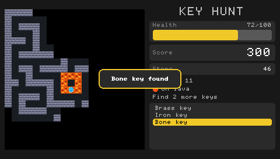

# PSP2DC Companion

**Extending the Dreamcast with a Programmable Second Screen**

| | |
|---|---|
| Document type | Concept and Architecture Proposal |
| Status | Draft v0.1. Phases 1 and 2 and the first part of phase 3 are built and tested without hardware (Appendices B to D). On a Dreamcast, phase 1's path is measured and the demo runs with its dashboard on the PSP (B.9). Phase 4 (files) is built and passed on a Dreamcast (Appendix E); input focus is built (Appendix F) |
| Target platforms | Sega Dreamcast, KallistiOS, Sony PSP, RP2040 |
| Project | PSP2DC |

---

## 1. Executive Summary

PSP2DC Companion is a proposed extension to PSP2DC that allows Sega Dreamcast games to use a connected Sony PSP as a programmable, full-color second screen and extended storage device.

The project builds upon PSP2DC's existing ability to transform a PSP into a Dreamcast controller, Visual Memory Unit (VMU), keyboard, and virtual memory card manager through an RP2040-based Maple adapter.

While the original Dreamcast VMU provides a monochrome 48 × 32 display and approximately 100 KB of usable save storage, the PSP offers a 480 × 272 color display, considerably more processing power, and removable Memory Stick storage.

PSP2DC Companion aims to make these capabilities directly accessible to Dreamcast homebrew developers through a dedicated KallistiOS library and an extended Maple communication protocol.

Rather than transmitting a continuous video stream, games will send compact graphics commands, UI updates, events, and data. The PSP will render and manage the resulting interface locally.

The long-term objective is to establish an open, extensible second-screen platform for Dreamcast homebrew while maintaining compatibility with existing Dreamcast games and peripherals.

## 2. Background

### 2.1 The Original Dreamcast VMU

The Sega Dreamcast introduced the Visual Memory Unit as a memory card with a small LCD, controls, and standalone functionality.

Games could use the VMU to display information independently of the television, including animations, status indicators, and gameplay-related content.

However, the original hardware imposed significant limitations:

- 48 × 32 monochrome LCD.
- Limited memory card capacity.
- Restricted graphical capabilities.
- Small physical display.
- Limited interaction possibilities.

Despite these constraints, the VMU demonstrated the potential of a secondary display integrated into a console's controller ecosystem.

### 2.2 The Existing PSP2DC Project

PSP2DC already provides a working connection between a Sony PSP and a real Dreamcast through an RP2040 adapter.

Its existing capabilities include:

- Dreamcast controller emulation using PSP controls.
- Live VMU display on the PSP.
- Color themes and enhanced VMU presentation.
- Virtual memory cards stored on the PSP Memory Stick.
- Multiple memory cards, backups, and save management.
- Automatic per-game VMU selection through openMenu Game IDs.
- Standalone VMU emulation and minigames.
- Dreamcast keyboard emulation.

Communication between the PSP and RP2040 uses a custom bidirectional USB protocol rather than USB HID.

The RP2040 acts as a USB host and translates between the PSP and the Dreamcast Maple bus.

This architecture provides a foundation for extending the PSP's role beyond emulating existing Dreamcast peripherals.

## 3. Vision and Objectives

The central idea is to evolve the PSP from a replacement VMU into an intelligent, programmable Dreamcast companion device.

A Dreamcast game should be able to detect a connected PSP2DC device and use its display, storage, and input capabilities through a simple programming interface.

Potential applications include:

- Live maps and navigation.
- Character statistics and status indicators.
- Inventory management.
- Quest journals and objectives.
- Racing telemetry.
- Strategy game minimaps.
- Game-specific menus.
- Secondary player information.
- Extended save storage.
- Interactive companion applications.

The companion interface should operate alongside standard Dreamcast controller and VMU functionality.

### 3.1 Primary Objectives

1. Expose PSP2DC companion functionality through KallistiOS.
2. Enable bidirectional communication between Dreamcast applications and the PSP.
3. Support rich graphical interfaces without requiring continuous framebuffer transmission.
4. Allow developers to use the PSP Memory Stick for extended game storage.
5. Preserve normal controller and VMU compatibility.
6. Provide an accessible API for Dreamcast homebrew developers.
7. Establish an open protocol that can evolve independently of the PSP2DC application.

### 3.2 Non-Goals

The initial implementation will not attempt to:

- Stream the Dreamcast's video output to the PSP.
- Mirror the Dreamcast framebuffer.
- Replace the standard Maple controller protocol.
- Modify commercial Dreamcast games automatically.
- Provide arbitrary access to Dreamcast memory.
- Require companion support for normal gameplay.

Existing games will continue to benefit from PSP2DC's standard controller and VMU functionality. The new companion features will require explicit integration by game developers.

## 4. Proposed Architecture

The system will consist of four principal components.

### 4.1 Dreamcast Application

A KallistiOS-based game uses the PSP2DC Companion API to send graphics, text, game state, and storage requests.

The application does not need to understand USB communication or the internal implementation of the RP2040 adapter.

### 4.2 KallistiOS Companion Library

A proposed library, `libpsp2dc`, provides:

- Device detection.
- Capability negotiation.
- Display and UI commands.
- Input events.
- Extended storage access.
- Asynchronous communication.
- Error handling.

The library communicates with a PSP2DC-specific Maple function exposed by the adapter.

### 4.3 RP2040 Maple-to-USB Bridge

The RP2040 adapter continues to emulate standard Dreamcast peripherals while adding support for the companion protocol.

Its responsibilities include:

- Maple function advertisement.
- Companion command handling.
- Packet forwarding.
- Message fragmentation and reassembly.
- Flow control.
- Prioritization of critical controller and VMU traffic.

The existing PSP2DC USB protocol will be extended to carry companion messages.

### 4.4 PSP2DC Application

The PSP application receives companion commands and provides:

- Local graphics rendering.
- UI layout and compositing.
- Cached assets.
- Interactive controls.
- Memory Stick storage.
- Device status and system overlays.

The PSP maintains the current companion interface locally, allowing it to update individual elements without retransmitting the entire display.

### 4.5 Communication Flow

```
+---------------------------------------+
|          Dreamcast Homebrew           |
|                                       |
|          KallistiOS + libpsp2dc       |
+---------------------------------------+
                    |
                    | Companion API
                    v
+---------------------------------------+
|             Maple Protocol            |
|                                       |
| Controller / VMU / Companion Function |
+---------------------------------------+
                    |
                    v
+---------------------------------------+
|              RP2040-Zero              |
|                                       |
|       Maple Peripheral Emulator       |
|          USB Host / Bridge            |
+---------------------------------------+
                    |
                    | Bidirectional USB
                    v
+---------------------------------------+
|               Sony PSP                |
|                                       |
|            PSP2DC Runtime             |
|                                       |
|  Rendering | UI | Assets | Storage    |
+---------------------------------------+
```

## 5. Companion Display Model

### 5.1 Display Partitioning

The PSP has a native resolution of 480 × 272 pixels.

Rather than treating the entire display as a single framebuffer, PSP2DC Companion will support independently managed display regions.

An initial recommended layout is:

| Region | Dimensions | Purpose |
|---|---|---|
| Game viewport | 240 × 240 | Dynamic graphical content |
| Information area | Approximately 240 × 272 | Status, statistics, inventory, text |
| System overlay | Configurable | PSP2DC controls and notifications |

The game viewport could display a minimap, animation, radar, or other dynamic graphical content.

The information area would contain structured UI elements that change relatively infrequently.

The PSP2DC system overlay would remain under the control of the PSP application.

These dimensions are proposed defaults, not fixed protocol limitations.

### 5.2 Independent Region Updates

Each display region will support independent updates.

For example:

- A minimap updates several times per second.
- Health changes only when the player takes damage.
- Inventory updates when items are added or removed.
- Quest text changes when an objective is completed.
- Connection and VMU status are managed locally.

This approach reduces communication overhead and allows each region to use an appropriate update frequency.

### 5.3 Local Rendering

The PSP will be responsible for rendering text, shapes, widgets, sprites, and cached graphics.

Instead of transmitting a complete image whenever a value changes, the Dreamcast sends a compact update.

For example:

```c
psp2dc_widget_set_u32(WIDGET_HEALTH, 84);
```

The PSP updates the corresponding health indicator using its local rendering system.

This separation makes the interface more efficient and simplifies game-side integration.

## 6. Graphics and Rendering Protocol

The proposed protocol will support several rendering mechanisms.

### 6.1 Structured UI Commands

These are intended for common interface elements:

- Text labels.
- Numeric values.
- Progress bars.
- Status indicators.
- Lists.
- Inventory grids.
- Icons.
- Notifications.

The PSP renders the elements according to the active layout and theme.

### 6.2 Drawing Commands

Games may issue basic drawing operations:

- Draw rectangle.
- Draw line.
- Draw text.
- Draw sprite.
- Clear region.
- Set palette.
- Set clipping rectangle.
- Present changes.

These commands allow custom interfaces without requiring developers to generate raw framebuffers.

### 6.3 Indexed-Color Graphics

The dynamic game viewport may support indexed-color bitmap data.

Potential formats include:

- 1-bit monochrome.
- 4-bit indexed color.
- 8-bit indexed color.
- RGB565 for selected operations.

Indexed-color formats reduce bandwidth and are suitable for maps, pixel art, and many game-specific interfaces.

### 6.4 Partial Framebuffer Updates

For applications requiring direct pixel manipulation, the protocol will support dirty-rectangle updates.

Only modified portions of a region will be transmitted.

For example, updating a 32 × 32 region in 8-bit indexed color requires 1,024 bytes of pixel data, excluding protocol overhead.

This is substantially smaller than transmitting the entire 240 × 240 viewport.

### 6.5 Asset Caching

Graphics assets may be stored on the PSP Memory Stick.

Examples include:

- Background images.
- Maps.
- Sprites.
- Icons.
- Fonts.
- Interface themes.

A game can reference these assets using identifiers rather than retransmitting them.

Asset packages may be installed separately or transferred through the companion protocol.

The protocol should include asset-version and availability checks so games can detect missing or incompatible assets.

## 7. Bandwidth Strategy

Bandwidth efficiency is a fundamental design requirement.

A complete 480 × 272 RGB565 framebuffer requires 261,120 bytes.

A 240 × 240 RGB565 viewport requires 115,200 bytes.

Even the reduced viewport would be expensive to transmit continuously over the proposed Maple communication path.

Therefore, the protocol will prioritize:

1. Structured UI updates.
2. Cached asset references.
3. Sprite positioning commands.
4. Partial framebuffer updates.
5. Indexed-color graphics.
6. Full-frame transfers only when necessary.

The actual achievable throughput must be measured on the RP2040-Zero hardware.

### 7.1 Traffic Prioritization

Communication should follow this priority order:

1. Time-critical controller responses.
2. VMU memory reads and writes.
3. Companion input events and control messages.
4. Small UI and game-state updates.
5. Graphics transfers.
6. Background asset transfers.

Large transfers must be fragmented and rate-limited.

Companion operations should be asynchronous wherever possible to avoid blocking the Dreamcast game loop.

## 8. KallistiOS Integration

### 8.1 Proposed Library

A dedicated library, tentatively named `libpsp2dc`, will provide a high-level interface to companion functionality.

The initial implementation may be distributed independently of KallistiOS.

Once the protocol and API have stabilized, integration into the upstream KallistiOS project can be considered.

### 8.2 Device Detection

Games should detect whether a compatible PSP2DC companion is connected.

The detection process should include:

- Device identification.
- Protocol version.
- Supported capabilities.
- Display resolution.
- Supported graphics formats.
- Storage availability.
- Input capabilities.

Applications must remain functional when the companion device is absent.

### 8.3 Proposed API

The following API is illustrative and subject to design changes.

```c
#include <psp2dc/psp2dc.h>

int main(void) {
    if (psp2dc_init() == 0) {
        psp2dc_set_title("My Dreamcast Game");
        psp2dc_text(10, 10, "Health: 85/100");
        psp2dc_progress(10, 35, 85, 100);
        psp2dc_present();
    }
    // Continue normal game execution.
}
```

A more complete API could provide:

```c
psp2dc_detect();
psp2dc_get_caps();
psp2dc_region_create();
psp2dc_region_clear();
psp2dc_draw_text();
psp2dc_draw_rect();
psp2dc_draw_sprite();
psp2dc_draw_bitmap();
psp2dc_widget_create();
psp2dc_widget_set_u32();
psp2dc_widget_set_text();
psp2dc_present();
psp2dc_poll_event();
psp2dc_storage_read();
psp2dc_storage_write();
```

The API should favor nonblocking operations, explicit status reporting, and predictable resource usage.

## 9. Maple Protocol Extension

The preferred approach is to introduce a PSP2DC-specific companion function through the Maple peripheral interface.

The adapter would advertise the function alongside supported standard peripheral functionality.

The design must establish:

- A suitable function identifier.
- Device enumeration behavior.
- Command and response formats.
- Maximum payload sizes.
- Fragmentation and reassembly.
- Protocol version negotiation.
- Error detection and recovery.
- Compatibility with existing Maple devices.

The exact mechanism requires validation against the Maple protocol and KallistiOS implementation.

Normal VMU block addresses and filesystem operations should not be repurposed for companion traffic.

### 9.1 Bidirectional Communication

The protocol must support both directions.

Dreamcast to PSP:

- UI commands.
- Graphics updates.
- Game-state values.
- Asset requests.
- Storage operations.
- Notifications.

PSP to Dreamcast:

- User interaction events.
- Command acknowledgements.
- Storage results.
- Device status.
- Capability information.

This would allow interactive companion applications rather than passive displays.

## 10. Extended Storage

The PSP Memory Stick can provide storage beyond the limits of standard Dreamcast VMUs.

PSP2DC Companion will distinguish between two storage systems.

### 10.1 Standard Virtual VMU Storage

Existing Dreamcast games continue to access standard VMU images.

PSP2DC manages these images through its current memory card system.

Compatibility with commercial Dreamcast software remains a priority.

### 10.2 Companion Extended Storage

Companion-aware homebrew games may use additional Memory Stick capacity through a dedicated API.

Potential applications include:

- Larger save files.
- User-generated levels.
- Custom maps.
- Replay recordings.
- Game configuration.
- Downloadable content.
- Companion graphics assets.

A proposed storage API could resemble:

```c
psp2dc_storage_write(
    "levels/map01.dat",
    data,
    size
);
```

Each game should receive an isolated storage namespace.

The implementation should provide:

- Per-game directories.
- File-size and quota controls.
- Read/write error handling.
- Atomic writes where practical.
- Data integrity checks.
- Protection against path traversal.
- Clear behavior when the PSP is disconnected.

Extended storage is not intended to transparently enlarge the standard VMU filesystem. It is a separate capability available to explicitly compatible games.

## 11. Companion Input

The PSP's controls can also be used to interact with the companion interface.

Examples include:

- Navigating an inventory.
- Selecting map markers.
- Scrolling a quest journal.
- Choosing items.
- Confirming secondary actions.

The protocol should distinguish companion input from standard Dreamcast controller input.

This avoids unintended gameplay actions while navigating PSP-specific interfaces.

Developers should be able to define which buttons are assigned to companion interaction and how input focus is handled.

## 12. Developer Experience

PSP2DC Companion should be straightforward for homebrew developers to adopt.

The proposed developer package will include:

- KallistiOS library.
- Public protocol specification.
- API reference.
- Example applications.
- Sample companion layouts.
- Asset conversion tools.
- Debugging utilities.
- Reference firmware implementation.

A small example should demonstrate how to detect the device, display a message, update a value, and receive an input event.

More advanced examples could demonstrate maps, sprite rendering, and extended storage.

The protocol should remain open so that other devices or emulators could potentially implement compatible companion functionality.

## 13. Reference Demonstration

The initial demonstration should be a simple KallistiOS game featuring a live companion dashboard.

The Dreamcast television displays the main gameplay.

The PSP displays:

- A 240 × 240 live minimap.
- Player position.
- Health and status.
- Current objective.
- Inventory information.

The player can navigate the companion interface without interrupting gameplay.

The demonstration should verify:

1. Successful device detection.
2. Bidirectional command exchange.
3. Independent display region updates.
4. Acceptable communication latency.
5. Reliable controller and VMU operation.
6. Graceful behavior when the PSP is disconnected.
7. Extended storage read/write operations.

The reference application should also measure Maple throughput, message latency, and the impact of companion traffic on controller responsiveness.

## 14. Development Roadmap

### Phase 1: Protocol Proof of Concept

- Define the companion device identity.
- Implement basic Maple command exchange.
- Extend RP2040 USB forwarding.
- Display text on the PSP.
- Return a simple PSP input event.

**Milestone:** A KallistiOS application sends a message to the PSP and receives a response.

**Status:** built, tested without hardware (Appendix B) and measured on a Dreamcast (B.9).

### Phase 2: Structured Display

- Implement display regions.
- Add text and drawing commands.
- Introduce basic UI widgets.
- Support independent updates.
- Add capability negotiation.

**Milestone:** A Dreamcast game displays a live dashboard on the PSP.

**Status:** built and tested without hardware (Appendix C); the demo's dashboard runs on a Dreamcast (B.9).

### Phase 3: Graphics and Assets

- Add indexed-color graphics.
- Implement partial framebuffer updates.
- Support cached sprites and backgrounds.
- Develop asset conversion tools.
- Measure and optimize throughput.

**Milestone:** A game displays a live graphical minimap with acceptable performance.

**Status:** the first part (bitmaps, palettes, sprites, the image converter) is built and tested without hardware (Appendix D), and the demo's sprites run on a Dreamcast (B.9); D.6 lists what is left.

### Phase 4: Extended Storage

- Implement file operations.
- Add per-game storage namespaces.
- Support asynchronous transfers.
- Implement integrity and recovery mechanisms.

**Milestone:** A KallistiOS game stores and retrieves data from the PSP Memory Stick.

**Status:** built, checked on the computer and on a Dreamcast (Appendix E).

### Phase 5: Developer SDK

- Stabilize the API.
- Publish documentation.
- Provide sample applications.
- Develop a reference game.
- Gather feedback from Dreamcast homebrew developers.

**Milestone:** External developers can integrate PSP2DC Companion into their games.

### Phase 6: KallistiOS Integration

- Review the Maple driver design.
- Evaluate upstream integration.
- Refine the public API.
- Establish compatibility and versioning policies.

**Milestone:** PSP2DC Companion becomes a reusable, documented extension for Dreamcast homebrew development.

## 15. Technical Challenges

Several areas require investigation before implementation.

**Maple throughput.** Actual usable bandwidth and command latency must be measured under realistic gameplay conditions.

**Peripheral enumeration.** The proposed companion function must coexist with standard controller and VMU functionality without confusing Dreamcast software.

**RP2040 resources.** Firmware memory, buffering, USB scheduling, and PIO timing must be evaluated.

**PSP rendering performance.** The PSP must process companion updates while maintaining controller input, VMU emulation, and other PSP2DC features.

**Connection reliability.** The system must handle temporary disconnections, incomplete transfers, timeouts, and device resets.

**Compatibility.** Companion functionality must not compromise the operation of existing Dreamcast games or standard Maple peripherals.

## 16. Long-Term Possibilities

Once the basic companion protocol is established, additional capabilities become possible:

- Game-specific UI themes.
- Interactive maps and inventories.
- Companion minigames.
- Game-specific save inspectors.
- Replay and telemetry visualization.
- Shared companion asset libraries.
- More sophisticated second-screen applications.
- Support for additional companion devices.
- Emulator integration for development and testing.

The protocol could eventually become independent of the PSP hardware, allowing other clients to implement compatible displays and storage services.

## 17. Conclusion

PSP2DC has already demonstrated that a Sony PSP can function as a sophisticated Dreamcast peripheral through an RP2040-based Maple adapter.

PSP2DC Companion proposes the next step: allowing Dreamcast homebrew developers to use the PSP as a programmable second screen and extended storage device.

By combining a KallistiOS library, an extensible Maple protocol, efficient graphics commands, and PSP-side rendering, the system could provide functionality far beyond the original Dreamcast VMU.

The design deliberately avoids continuous framebuffer streaming, favoring independently updated display regions, structured UI elements, and cached graphical assets.

The initial objective is modest but important:

> Enable a Dreamcast homebrew application to detect PSP2DC, display a rich interactive dashboard on the PSP, exchange input events, and access extended storage while preserving normal controller and VMU operation.

Achieving this would establish the foundation for an open second-screen ecosystem for Dreamcast homebrew.

## 18. Open Design Decisions

**Widgets first, or raw graphics first.** Whether the companion protocol exposes high-level UI widgets as its primary interface, with raw graphics as an optional capability. Widgets first reduces bandwidth, simplifies development, and leaves room for devices beyond the PSP. To be settled before implementation.

Settled on 20 November 2026 for widgets first (A.4): phase 2 is widgets, with drawing commands into regions beside them, and bitmaps left to phase 3 (Appendix C).

---

## Appendix A. Constraints Checked So Far (20 November 2026)

Facts that bear on sections 7, 9 and 15, from the KallistiOS source (master, 15 November 2026), Marcus Comstedt's Maple pages, openMenu's source, and PSP2DC's own firmware and hardware tests. "Derived" marks a figure worked out from the sources, not measured.

### A.1 Where the companion function can live

- **Not as an extra function bit on the controller.** KallistiOS binds one driver to a device ("For now we just pick the first matching driver", `maple_driver.c`), so a controller that also advertised a companion function would get the controller driver only. Commercial games are a second risk: with the pad and the keyboard advertised as one device, Typing of the Dead never read the keyboard (docs/psp2dc.md, 5.0e7).
- **Custom commands to a unit that already exists need no driver and no new function.** openMenu sends command 0x21 (the Game ID) to a memory card with `MAPLE_FUNC_MEMCARD`, using the unit's own frame (`vm2_api.c`); it picks its targets by the name in the unit's all-status reply. PSP2DC's adapter already takes that command during normal play with no effect on games (5.0e5). This is the lowest-risk start: a few new command numbers, clear of Sega's (1 to 14), of 0x21, and of the NAOMI ones (0x80 to 0x87).
- **A sub-unit of its own with an unassigned function code** is the cleaner end state. KallistiOS leaves several codes unassigned (for example 0x00100000 to 0x00800000 in its byte order); no convention for vendor codes was found. Two costs: a driver must be registered before `maple_init`, which runs before `main()`, and a sub-unit whose function has no driver is probed once and then ignored until replugged. How commercial games treat an unknown sub-unit is untested.

### A.2 Throughput, Dreamcast to PSP

- A Maple frame carries at most 255 words (1020 bytes) of payload; KallistiOS's frame buffers are sized for that.
- KallistiOS sends queued frames once per vertical blank. A unit has one frame of its own, so a driver using it sends one command per vblank: about 60 commands and about 61 KB a second at most (derived). More than one frame to a unit per vblank is possible in the queue (an application can own extra frames) but is not verified on hardware.
- At that ceiling a full 240 × 240 viewport takes about 1 s in 8-bit colour and about 2 s in RGB565; a 32 × 32 tile in 8-bit colour fits one frame. Live content therefore has to be commands and cached assets, as section 7 proposes; bitmaps suit tiles and one-off pictures.
- From the adapter to the PSP the USB link is half duplex: the adapter sends when a message from the PSP arrives, which is once per PSP frame today (about 60 transfers a second; a card block is 536 bytes in one transfer). The pacing and the transfer size can be raised; what the link then carries is to be measured.

### A.3 Replies and the PSP to Dreamcast direction

- Maple is polled: a peripheral speaks only in reply to a command. Input events, storage results and acknowledgements reach the game only when it asks, so the library needs a poll command (once per vblank, or riding on every reply).
- The Dreamcast waits about 1 ms for a reply (KallistiOS sets the timeout register to 50000 units of 20 ns; derived). Late replies made games see the controller leave and return (5.0e6). A round trip to the PSP takes a frame or more, so the adapter must answer every companion command at once from its own buffers and forward afterwards. Anything that needs the PSP's answer (a storage read, a capability query) is a request now and a result on a later poll.
- Back-pressure exists already: a peripheral may answer "again" (0xFC), and KallistiOS then resends the frame at the next vblank without the driver seeing it, with no retry limit. The adapter can use it while its buffer is full, and must answer an error instead when the PSP is not there, or the frame is resent forever.

### A.4 What this suggests

- **Section 18:** the limits favour widgets and drawing commands as the primary interface, with bitmaps as an optional capability.
- **Section 9:** start with custom commands to an existing unit (A.1); consider a function code of its own with phase 6.
- **Roadmap:** put a measurement step before phase 2: a KallistiOS test program that sends commands of 4 to 1020 bytes and counts what arrives on the PSP, with a game's normal controller and VMU traffic running. It settles the frame budget every later phase depends on.
- **Testing:** no emulator has this adapter, so each test runs on a Dreamcast (a disc image on the GDEMU card). KallistiOS's toolchain is not set up for this project yet.

### A.5 Sources

- KallistiOS: `kernel/arch/dreamcast/include/dc/maple.h`, `hardware/maple/maple_irq.c`, `maple_queue.c`, `maple_driver.c` (github.com/KallistiOS/KallistiOS).
- Marcus Comstedt, Maple bus: mc.pp.se/dc/maplebus.html, mc.pp.se/dc/maplewire.html.
- openMenu Virtual Folder Bundle, `vm2_api.c` (github.com/DerekPascarella/openMenu-Virtual-Folder-Bundle).
- The timeout's unit: the Linux Maple driver's comment, `drivers/sh/maple/maple.c`.
- PSP2DC: docs/psp2dc.md, sections 5.0e5 to 5.0e7.

---

## Appendix B. Phase 1 Design (20 November 2026)

The proof of concept and the measurement step in one: a KallistiOS program finds the companion, sends text and test data to the PSP, and gets PSP button events back, while the controller and the VMU work as before.

### B.1 The Maple side

- **One new Maple command, 0x50**, sent to the memory card unit with the memory card's function code in word 0, as openMenu's 0x21 is (A.1). The library uses a frame of its own, so it does not wait on the VMU driver's.
- **Request**, after the function word: `op` (1 byte), `seq` (1), `len` (2, little-endian), then `len` bytes of data, padded to a word. `op` 0 HELLO, 1 SEND (data for the PSP), 2 POLL (nothing to send).
- **Reply**, a data transfer (8), after the function word: `status` (0 fine, 1 no PSP), `session` (changes each time the PSP's link opens, so both sides know to start over), `seq` echoed, a spare byte, `room` (2: bytes free in the adapter's buffer towards the PSP), `len` (2), then `len` bytes from the PSP. Every reply carries what the PSP has sent since the last one, so any command is also a poll. HELLO's reply data is `PSP2DC`, the protocol version and a spare byte.
- **Full buffer:** the adapter answers "again" (0xFC) and KallistiOS resends at the next vblank (A.3). **No PSP:** status 1, the data dropped.
- **A lost reply:** the library sends the command again with the same `seq`, and the adapter takes a SEND's data once per `seq`.
- The adapter answers from two byte queues in its RAM, one each way, and never waits for the PSP.

### B.2 The USB side (protocol 7)

- `COMP_DATA` (adapter to PSP) and `COMP_EVENT` (PSP to adapter): each a piece of the byte stream in that direction, up to 255 bytes a message, several messages a transfer.
- The stream is a run of records: `type` (1), `len` (2), data. A record is at most 1000 bytes, so one fits a Maple frame. A record from the PSP is at most 56 bytes and goes whole in one message.
- `COMP_RESET` (adapter to PSP) comes before a session's first bytes. A session begins when the PSP's link opens, when the PSP is back after a silence, and when a transfer carrying companion bytes failed; what was on its way either way is dropped, and the Dreamcast program sees the new session number in the next reply.
- The adapter's transfers to the PSP grow from 576 to 1280 bytes at most: the companion's bytes ride after whatever else a transfer carries (a VMU screen, a status), so a game drawing the VMU every frame does not hold them back.

### B.3 Records in phase 1

| Direction | Record | Content |
|---|---|---|
| Dreamcast to PSP | CLEAR | none |
| Dreamcast to PSP | PRINT | a row, then text for that row |
| Dreamcast to PSP | TEST | a running number, then a known pattern (the PSP checks both and counts) |
| Dreamcast to PSP | ECHO | any bytes: the PSP sends them back |
| PSP to Dreamcast | BUTTONS | the PSP's buttons, when they change |
| PSP to Dreamcast | ECHO | the bytes of an ECHO |

### B.4 The three programs

- **Adapter:** the command above in the VMU's command handler, and the two queues, in one new file; the USB driver forwards them.
- **PSP:** while companion data arrives, the VMU page gives way to a companion page: the printed rows, and counts (bytes and records a second, errors found in TEST). The buttons still go to the Dreamcast as the controller's; focus is a later phase (section 11).
- **Dreamcast (`dreamcast/`):** `libpsp2dc` with detect, send, poll; and a test program that shows on the TV what it finds, then sends TEST records of 4, 64, 256 and 1000 bytes for a few seconds each, one command a vblank, and reports commands and bytes a second, the ECHO round trip in frames, the PSP's button events, and the controller's state throughout.

### B.5 What phase 1 answers

- Whether KallistiOS and the adapter exchange the new command with no effect on the controller and the VMU.
- The real throughput each way, and where it is lost (Maple, the adapter's queue, or USB: today the adapter sends the PSP one transfer of up to 576 bytes per PSP frame, about half the Maple ceiling).
- The round-trip time of a small message.

### B.6 As built (20 November 2026)

Built as designed, with what B.1 and B.2 now say. Measured on a Dreamcast on 22 November 2026 (B.9).

- **Adapter** (joypad-os patch 0014): the command and the two 4 KB queues are in the VMU's file (`vmu.c`), which has the unit's address and the RAM-resident copy routines the Maple path needs; the USB side is in `psp2dc_host.c`. Both targets build.
- **PSP:** `psp/app/companion.c` reads the stream; the page shows while bytes arrived in the last three seconds. System, Details has a line of the companion's counts on both ends. `ms0:/PSP2DC/dev_companion.txt` shows the page in PPSSPP without a Dreamcast (its lines as printed rows).
- **Dreamcast:** `dreamcast/libpsp2dc` (`psp2dc_init`, `psp2dc_update` once a frame, `psp2dc_print`, `psp2dc_record`, `psp2dc_poll`) and `dreamcast/test`. Only `psp2dc_init` waits (up to half a second for each memory card unit); after it, a program with no companion asks one memory card unit a second and goes on. `scripts/build-dreamcast.sh` builds the test with KallistiOS in Docker (the `kazade/dreamcast-sdk` image) and makes `build/psp2dc_test.cdi` for GDEMU.
- **The test** runs five sizes in turn, five seconds each: polls only, then TEST records of 4, 64, 256 and 996 bytes, one a frame. The TV shows commands and bytes a second for each size, errors, the ECHO round trip in frames, the PSP's buttons and the controller's state; X pauses, Y draws the VMU's screen every frame. The PSP shows what arrives a second and whether the TEST records came whole and in order.
- **Checked without hardware:** the PSP page in PPSSPP with sample rows; the rest is B.7.

### B.7 Checked without hardware (20 November 2026)

The three parts were run against each other on the computer. Nothing here says anything about the bus itself: the timing of a reply, a 1 KB frame on the wire and the real speeds still need a Dreamcast.

**The simulator** (`scripts/dev/companion-sim`) is the adapter and a PSP as one small library. The adapter's part is the firmware's own `vmu.c`, built for the computer, and the PSP's is `psp/app/companion.c`; the USB transfer between them is written again by hand after `psp2dc_host.c` (the same message sizes, the reset, the lost transfer).

**The library's test** (`scripts/dev/companion-test.sh`) runs `libpsp2dc` on that, with KallistiOS replaced by the seven functions it uses (and their checks). Ten cases, each from nothing:

| Case | What happens | What must hold |
|---|---|---|
| plain | 3000 frames of records of every size up to 1000 bytes | each arrives once, whole, in order; the printed rows are there |
| slow | the PSP takes a quarter of what is sent | "again" answers, nothing lost |
| lossy | a tenth of the commands and a tenth of the replies are lost | nothing lost, nothing twice |
| far-apart | two sends with 240 to 270 polls between them | both arrive |
| restarts | the PSP unplugged and back, transfers to it lost | the PSP's stream never loses its place; the program starts its page again and all is whole |
| psp-later | no PSP at first | records are refused until it is there |
| no-companion | a memory card that is no companion, then the adapter beside it in port B | no waiting, no errors counted, found within seconds |
| events | six button changes, six ECHOs | in order, the same bytes back |
| card-away | the memory card unit gone for up to two seconds, as when the PSP changes its card | found again; the program starts its page again |
| everything | all of it at once, 300 000 frames | as above |

**What it found**, all in `libpsp2dc`, now fixed:

- The command's `seq` moved on with every poll, so a SEND exactly 255 commands after the last one carried the same `seq`, and the adapter took it for a repeat and dropped it. Only SENDs count now.
- With no companion found, `psp2dc_update` waited up to half a second for each memory card unit, once a second: a game would have stopped that long. It now sends one HELLO a second and does not wait.
- When the companion went away for more than half a second, the records queued were dropped and the program was not told. `psp2dc_session()` now changes then too, so the program sends its page again.
- `psp2dc_idle()` was never true after `psp2dc_update()` (a poll is always out).

The same test fails on the library as it was before these.

**In Flycast.** `scripts/dev/flycast-companion.sh` builds Flycast with the simulator behind port A's first memory card (`companion-sim/flycast.patch`, 54 lines), so the test disc runs on the real KallistiOS: its frame queue, its interrupt handlers, its resend of "again". The test disc there:

| Record size | Commands/s | Bytes/s | Errors |
|---|---|---|---|
| polls only | 60 | 81 | 0 |
| 4 | 60 | 498 | 0 |
| 64 | 60 | 4088 | 0 |
| 256 | 60 | 15 581 | 0 |
| 996 | 60 | 58 873 | 0 |

The round trip of an ECHO was 4 frames, the PSP's buttons arrived, and the simulated PSP counted no bad record. With a PSP reading a third as fast and unplugged every 11 seconds: 37 commands and 36 644 bytes a second at 996 bytes (the rest answered "again"), still no errors and no bad record. In the unchanged Flycast (its memory cards answer the command with "unknown"), the disc reports no companion, counts no errors and keeps running.

These are an emulator's figures: one command a vblank is KallistiOS's own pace, and the emulated bus neither loses nor delays anything. They show the library, the protocol and the adapter's queues agree; the 60 KB/s is the ceiling A.2 derived, not a measurement.

**Read in the source, for the same reason:** nothing in the adapter's receive path is sized below a 255-word frame (the ring is 4096 bytes, the packet buffer 1032, the reply goes out by DMA at any length), and the PSP's USB driver reads up to 64 KB a transfer, so the 1280-byte transfers fit.

**Worked out from the built firmware**, on the two questions that seemed to need the hardware:

- **The reply's timing.** Replies are made on Core 0 after its other work (docs/psp2dc.md, 5.0e6), so a reply is late when one pass of Core 0's loop is long, whatever the command. The companion adds two things to a pass. The command's handler, counted from the compiled code at 200 MHz (derived): about 55 µs to copy 1000 bytes that are not word-aligned and 13 µs when they are, 8 µs to sum a 1 KB reply, and about 15 µs for the byte swap of a 1 KB packet; under 0.1 ms for a full command with a short reply, about 0.15 ms at worst. And filling a transfer for the PSP, one copy of up to 1280 bytes. That leaves room in the bus's 1 ms, but only the Dreamcast shows the sum: the PSP's Details counts the replies begun 1 ms late and shows the longest wait (its `maple` lines), so those are read while the test runs.
- **Receiving a long frame** is the same loop as a short one: Core 1 takes each byte from the PIO's queue of a few entries as it comes, and nothing builds up over a frame's length. A loop slower than the wire would already lose the VMU's screen (a frame of about 200 bytes, far more than the queue holds), and those arrive whole on hardware.
- **The adapter's RAM** is not short: code and data take 234 400 of the 262 144 bytes of main RAM (the linker's map), no allocator is linked in, and both stacks are in the two 4 KB scratch banks outside it.

**Still open, for the Dreamcast:**

- Whether a pass of Core 0's loop stays under the bus's 1 ms with the companion's traffic (above).
- Whether frames this long arrive whole on the real wire, at the rate of one a vblank beside the controller's and the VMU's.
- The real speed to the PSP, and the round trip.

### B.8 The test on a Dreamcast

Done (B.9), but for step 2's readings with the demo running. What is needed: the adapter with the current firmware, the PSP with the current application, and the two discs of `scripts/build-dreamcast.sh` on the GDEMU card.

1. **`psp2dc_test.cdi`.** The television shows whether the companion is found, then commands and bytes a second and errors for each record size, and the round trip. The PSP shows what arrives and whether the test records came whole.
2. **On the PSP, Settings, Details, while the test runs:** the `maple` lines (replies begun 1 ms late, the longest wait, packets that failed their check) and the companion's line. This is where a late reply or a damaged long frame shows.
3. **Y on the controller** (the VMU's screen drawn every frame) and X (pause), then the same readings: the companion beside ordinary traffic.
4. **`psp2dc_demo.cdi`.** The maze on the television, the dashboard on the PSP; walk, take a key, stand in the lava; the PSP's L and R move the mark in the list. Unplug the PSP and plug it back, and change its card: the dashboard must come back whole each time.

The numbers of step 1 go into B.7's table beside the emulator's; errors at the larger sizes only would mean shorter records (`PSP2DC_COMP_DATA_MAX`), which nothing above depends on.

### B.9 On a Dreamcast (22 November 2026)

The test disc on a Dreamcast (GDEMU), the RP2040-Zero adapter and a PSP-1000:

| Record size | Commands/s | Bytes/s | Errors |
|---|---|---|---|
| polls only | 60 | 53 | 0 |
| 64 | 60 | 3998 | 0 |
| 256 | 60 | 15 283 | 0 |
| 384 | 60 | 22 809 | 0 |
| 497 | 60 | 29 454 | 0 |
| 501 | 60 | 29 689 | 0 |
| 640 | 60 | 37 862 | 0 |
| 768 | 60 | 45 389 | 0 |
| 896 | 60 | 52 915 | 0 |
| 996 | 60 | 58 795 | 0 |

The round trip of an ECHO was 3 to 8 frames, 4 as a rule, and all 50 came back. These are the emulator's figures (B.7): the bus carries a command a vblank at any length, and B.7's three open questions are answered for the test's traffic. With the VMU's screen drawn every frame as well (Y), every figure was the same, again without an error.

**The demo disc** runs there too: the maze on the television, and on the PSP the explored map drawn from sprites, health, score, steps and the list of keys, each following the game. At the first try the PSP froze and switched itself off as the demo started. `comp_screen.o` had been built before `companion.h` gained a region's palette and the sprites, and the PSP application's Makefile knew no headers, so it was never built again: the drawing read a palette's colours as a second region's size and pixels. The demo's records fed to that build in PPSSPP (`dev_companion.bin`) stopped the emulator at the PALETTE record; built afresh, it draws the dashboard. The Makefile now builds an object again when a header it uses changes. The PSP's L and R move the mark in the list, and the dashboard comes back whole after the PSP is unplugged and plugged in again, and after its card is changed, while the demo runs.

**What it took.** At first every command of 512 bytes and more was lost, and those of 256 ran without an error. The adapter counted no frame with a bad check and none unanswered: its receiver lost the frame at its start. A frame's first byte is its length in words, so from 128 words its first bit is a 1. The receiver's state machine (joypad-os's, from MaplePad) expected pin 5 to fall before every bit's clock, which holds for every bit but the first: after the start pattern both lines are high, and a first bit of 1 is pin 1 falling at once. No controller or memory card command is 128 words long, so nothing had met this. One more state takes it (firmware patch 0016); `scripts/dev/maple-rx-test.sh` runs the receiver's tables over frames of every length on the computer (0 to 127 words read before the fix, all 256 lengths after), and the new tables differ from the old only where the old gave an error.

**How it was found.** The adapter's status gained the receiver's counts (frames broken off and where, line errors, the longest frame received whole, its FIFO running full), shown in Settings, Details: the long frames broke at 0 bytes, with the FIFO never full. A copy of the receiver's raw bytes around a lost frame, sent to the PSP, showed a clean frame read half a bit out of step from its first bit on. That capture is not kept in the firmware. A later one, which also read the clock at each frame's start and end, slowed the receive loop enough to fill the FIFO and lose frames of every size: the loop on Core 1 has no time to spare, and nothing should be added to it.

**The test disc** now goes through its ten sizes once, five seconds each, whatever becomes of a size (the library gives a companion that stops answering up, and finds it again), and ends with the longest that ran without an error. 497 and 501 bytes are the two sides of 128 words. While a program uses the companion, the PSP writes the adapter's counts a second to `PSP2DC/companion_log.txt`.

---

## Appendix C. Phase 2: The Screen (20 November 2026)

Widgets, drawing regions and a way to ask what the PSP can show, built on phase 1's path. Run against the simulator, in PPSSPP and in Flycast (C.6); not yet on a Dreamcast. The adapter is not touched: it carries the new records as it carries any bytes, so phase 1's firmware serves.



### C.1 Decisions

- **Widgets first** (section 18). At 61 KB a second at most (A.2) a value that changes should cost a few bytes, and a program should not have to draw a health bar.
- **The whole screen is the program's** (480 × 272) once it has a widget or a region: no header and no line of keys. SELECT still opens PSP2DC's menu, and PSP2DC's own notices are drawn over the program's screen: that is the system overlay of 5.1.
- **Widgets live on the PSP and are remembered by the library.** A program makes them once and sets values as often as it likes; the library sends only what changed, and everything again when the PSP starts over. So a program need not know whether a PSP is there, or when it came back.
- **Regions are drawn into, not described.** A region is a rectangle of pixels with two copies: drawing goes to one, PRESENT shows it. The PSP keeps the pixels, so a program draws only what changes (a tile, a marker). What was drawn is not remembered by the library: when the session changes, the program draws its regions again.
- **Regions under widgets, widgets in the order of their ids.** No transparency.
- **Asking what the PSP can show** is between the program and the PSP (QUERY, CAPS). A PSP application older than this ignores the records and does not answer, and the program sees that no answer came.
- **A word a second.** The PSP shows the companion's screen while its bytes arrive, so the library sends an empty record (NOP) when a second passes with nothing else to send. Three seconds without any, and the PSP is back on its own page: a program that ended, or a Dreamcast switched off.

### C.2 Records

Dreamcast to PSP, after phase 1's (B.3). Coordinates are signed 16-bit pixels, colours RGB565, text ASCII.

| Record | Data | Does |
|---|---|---|
| NOP 0x00 | none | the program is still there |
| QUERY 0x03 | none | the PSP answers with CAPS |
| RESET 0x04 | none | every widget and region removed |
| WIDGET 0x10 | id, type, flags, x, y, w, h, colour, value, max (22 bytes), text | a widget made, or made again |
| VALUE 0x11 | id, value (4) | its value |
| TEXT 0x12 | id, text | its text |
| REMOVE 0x13 | id | gone |
| NOTIFY 0x14 | text | a line over the screen for 2.5 s |
| REGION 0x20 | id, x, y, w, h | a region made, black (every region is emptied); w or h 0 removes it |
| FILL 0x21 | id, x, y, w, h, colour | a filled rectangle |
| LINE 0x22 | id, x0, y0, x1, y1, colour | a line |
| DRAWTEXT 0x23 | id, x, y, colour, size, text | text, 1 to 4 times the 8-pixel font |
| CLIP 0x24 | id, x, y, w, h | drawing kept inside from here on |
| PRESENT 0x25 | id | what was drawn shows |

PSP to Dreamcast: CAPS 0x02 (20 bytes): level (2), how many widgets (64) and regions (4), a widget's longest text (200), the screen's size, the pixels all regions may have together (480 × 272), the widget types known (a bit each), the bitmap formats known (none yet).

A record for a widget or a region that is not there is skipped without complaint: after the PSP starts over, a few such records from before are still on their way.

### C.3 Widgets

The PSP draws them in its theme's colours; a widget may carry a colour of its own.

| Type | Shows | Its value | Its text |
|---|---|---|---|
| LABEL | a line of text; twice the size, centred or at the right by its flags | | the line |
| NUMBER | a caption at the left, a number at the right | the number | the caption |
| BAR | a bar; when 20 pixels or taller, the caption and "value/max" above it | how full, of max | the caption |
| LIGHT | a dot, lit or not, and a caption | lit when not 0 | the caption |
| LIST | lines, one of them marked; a page of them at a time | the marked line, -1 for none | the lines, parted by line feeds |

A flag puts a panel behind any of them.

### C.4 The library

```c
psp2dc_init();
psp2dc_widget_create(HEALTH, PSP2DC_WIDGET_BAR, PSP2DC_WF_PANEL, 256, 36, 216, 36, "Health");
psp2dc_region_create(0, 8, 16, 240, 240);
for (;;) {
    vid_waitvbl();
    psp2dc_update();
    psp2dc_widget_set_u32(HEALTH, health);          /* sent only when it changes */
    if (psp2dc_session() != session) {              /* the PSP is new: its regions are empty */
        session = psp2dc_session();
        draw_whole_map();
    }
    psp2dc_draw_rect(0, x * 12, y * 12, 12, 12, PSP2DC_RGB565(60, 200, 250));
    psp2dc_present(0);
}
```

- Widgets: `psp2dc_widget_create`, `_set_u32`, `_set_text`, `_set_range`, `_set_colour`, `_remove`; `psp2dc_screen_reset` removes everything. None of them sends or fails for want of room: `psp2dc_update` sends what changed when the queue has room.
- Regions: `psp2dc_region_create`, `_remove`, `_clip`, `psp2dc_draw_rect`, `_draw_line`, `_draw_text`, `psp2dc_present`. These queue a record at once and say when they cannot (the queue is full, or no PSP is there), so a program draws what fits now and the rest next frame.
- `psp2dc_notify`, `psp2dc_get_caps`.
- `psp2dc_session()` now changes only once the library has started the PSP's screen for the new session, so whatever a program draws on seeing the change lands after that.

### C.5 As built

- **PSP:** `psp/app/companion.c` keeps the widgets and the regions' pixels (about 1 MB set aside) and does the regions' drawing; `psp/app/comp_screen.c` draws the screen from them. Neither uses anything of the PSP's, so the simulator runs the same two files. `ui_page_screen` shows the result when something changed. `ms0:/PSP2DC/dev_companion.bin`, a file of records, is fed in at the start for trying it in PPSSPP.
- **Dreamcast:** `dreamcast/libpsp2dc` as in C.4. `dreamcast/demo` is a small game: a maze on the television, five keys to find, lava; the PSP shows the map as it is found out, health, score, steps, the tile stood on, a light for the lava, what to do next, and the keys carried, where the PSP's L and R move the mark. `scripts/build-dreamcast.sh` builds it as `build/psp2dc_demo.cdi` beside the test.
- **What it costs on the path:** a value 8 bytes, a widget 25 bytes and its text, a rectangle 14. The demo's whole screen, map and all, is about 6.6 KB when a PSP starts (with Appendix D's sprites); a step in the maze about 100 bytes.

### C.6 Checked without hardware

- **The library's test** (B.7) has two more cases, 12 in all, and all pass. `screen`: widgets made before a PSP is there, changed, removed; a region drawn into with clipping; CAPS; a region too large refused; a value set to what it already is sends nothing; the word a second. `screen-faults`: 100 000 frames of a program changing its widgets and its picture at random while commands and replies are lost, the PSP is slow, unplugged and back, and the memory card unit goes away; after each round the PSP must hold exactly what the program made and show its last picture. The library broken on purpose in two places (not sending everything again at a new session; a widget removed and made again in the same frame) fails it.
- **The demo on the computer.** `scripts/dev/companion-demo.sh` runs `dreamcast/demo` as it is against the simulator, with a controller that walks to three keys, and saves the PSP's screen (the picture above) and the records the PSP got.
- **The PSP application in PPSSPP**, fed those records as `dev_companion.bin`, draws the same screen.
- **In Flycast** with the simulator (B.7) the demo disc runs on the real KallistiOS: the maze on the television, the dashboard on the simulated PSP's screen, which `PSP2DC_SIM_SCREEN=file` saves as a picture ten times a second. The test disc gives the figures of B.7 as before.
- **Not checked:** how long the PSP takes to draw a full screen, the PSP's buttons reaching the demo on real hardware, and everything B.7 leaves to the Dreamcast (B.8).

### C.7 Left for later

- ~~Input focus (section 11)~~: done (Appendix F).
- Bitmaps, sprites, palettes and cached assets (phase 3); storage (phase 4).

---

## Appendix D. Phase 3, First Part: Pictures (20 November 2026)

Bitmaps with palettes, sprites the PSP keeps, and a converter for images. Tested as Appendix C was (D.5). Not here: assets kept on the Memory Stick (6.5), and the measuring, which needs the Dreamcast. The adapter is again untouched.

### D.1 Decisions

- **Four formats:** 1, 4 and 8 bits a pixel through a palette, and RGB565. A region has one palette of 256 colours; it starts as red, green and blue in an index's 3, 3 and 2 bits, so 8-bit pictures work with none set.
- **A bitmap goes in pieces.** A record holds as many whole rows as fit; `psp2dc_draw_bitmap` queues what the queue takes now and says how many rows went, and the program goes on with the rest next frame. It always leaves 1 KB of the 4 KB queue free, so a widget's change is never held up behind a picture (7.1).
- **A sprite is sent once and drawn by its number.** The program hands the library a picture that stays in its own memory; the library sends it a little each frame, behind everything else, and again when the PSP starts over. Drawing one is 12 bytes, with one index (or colour) left out when asked: the transparent part.
- **The PSP keeps sprites in RAM** (64 of them, 512 KB together) for the session only.

### D.2 Records

| Record | Data | Does |
|---|---|---|
| PALETTE 0x26 | region, first, colours | the region's palette from that entry on |
| BLIT 0x27 | region, x, y, w, h, format, rows | pixels into the region |
| SPRITE 0x28 | sprite, format, w, h, first row, rows | a sprite made (first row 0) or gone on with |
| DRAWSPRITE 0x29 | region, sprite, x, y, keyed, key | the sprite drawn in the region's palette |

CAPS says level 3 and adds the formats known, how many sprites and how many bytes of them.

### D.3 The library and the tool

- `psp2dc_region_palette`, `psp2dc_draw_bitmap`, `psp2dc_sprite_create`, `psp2dc_sprite_ready`, `psp2dc_draw_sprite` (`dreamcast/libpsp2dc/psp2dc.h`). The palette is remembered with its region and sent again with it.
- `dreamcast/tools/psp2dc-image.py picture.png name > name.h` turns a PNG into the pixels and the palette as C, in the smallest format its colours fit, with a key for what is transparent. It needs only Python.
- Several pictures side by side in one image can each be a sprite: the row distance passed to `psp2dc_sprite_create` is the whole image's. The demo's seven tiles are one 84 × 12 image, drawn by the same data on the television.

### D.4 What a picture costs (derived from A.2's ceiling)

| Picture | Bytes | Time at 60 KB a second |
|---|---|---|
| 240 × 240, 8 bits | 57 600 | about 1 s |
| 240 × 240, 4 bits | 28 800 | about 0.5 s |
| 240 × 240, 1 bit | 7 200 | 8 frames |
| a 32 × 32 tile, 8 bits | 1 024 | 2 frames |
| a sprite drawn | 12 | about 80 in a frame |

So a map made of tiles is sprites, sent once and then placed; a picture of the whole viewport is for a still.

### D.5 Checked without hardware

- **Two more cases** in the library's test, 14 in all, all passing. `pictures`: a palette, a bitmap in each format partly outside the region, each sprite drawn plain and keyed; the region must match, pixel for pixel, a model the test keeps by plain steps; the starting palette; a value set while a 40 KB bitmap goes arrives in 5 frames. `pictures-faults`: 60 000 frames of new pictures and palettes while everything of C.6 goes wrong, the region compared the same way after each round. The library broken on purpose in three places (sprites not sent again at a new session, the palette not sent again, no room left in the queue) fails them.
- **The converter** against another PNG decoder on a 480 × 272 image: no pixel differs.
- **The demo** with its tiles as sprites, on the simulator and, on the real KallistiOS, in Flycast: the picture in Appendix C.
- **Not checked:** this build of the PSP application running (phase 2's was seen in PPSSPP; the code added is the code the simulator runs), and everything on hardware.

### D.6 Left of phase 3

- Assets kept on the Memory Stick, with a version to ask for (6.5), so that a game's pictures are sent once ever, not once a session. Postponed: in [the optimisations list](optimisations.md).
- ~~The throughput measured~~: done, 59 KB a second (B.9).

---

## Appendix E. Phase 4: Files on the Memory Stick (23 November 2026)

A program keeps files of its own on the PSP's Memory Stick: a save larger than a VMU's, levels, replays, settings. Built, checked on the computer (E.6) and on a Dreamcast (E.7).

### E.1 What the path allows (from the code)

- **Dreamcast to PSP:** 59 KB a second, measured (B.9). Writing a file is about as fast.
- **PSP to Dreamcast:** a reply already carries up to 1000 bytes from the PSP, one reply a frame: 60 KB a second at most at the Maple end. Before that, the bytes cross USB from the PSP to the adapter, a direction that has carried only small records so far. A whole card (128 KB) goes up in a second or two when nothing else is sent; while the adapter also sends to the PSP, it reads only 64 bytes between two of its sends. How fast a file comes back is the number this phase has to measure (E.7).
- **No room is dropped, not waited for:** the adapter drops a message from the PSP when its 4 KB queue towards the Dreamcast is full, and the PSP cannot know. So the library never asks for more than fits (E.2, the windows).
- **Records from the PSP grow from 56 bytes to 255,** a USB message's whole payload (`PSP2DC_COMP_UP_MAX`). The adapter already took messages of any length; the 56 was the PSP's 64-byte send buffer, which its main loop keeps for the buttons and CAPS.
- **A lost reply lost the PSP's bytes in it.** The adapter took them from its queue whether or not the reply arrived, and the Dreamcast's copy of the stream was then out of step until the session changed. With buttons this was rare and small; a file's bytes need it fixed. Protocol 8 does (E.3), and that is the one change to the adapter.

### E.2 Decisions

- **A folder per program:** `ms0:/PSP2DC/games/<name>/`, the name given by the program (up to 16 of `a-z 0-9 - _`). Plain files, which can be copied off the Memory Stick with a computer.
- **Names inside it:** up to 63 of `a-z 0-9 . - _ /`, no part empty or starting with a dot. Nothing outside the folder can be named; the PSP's own files there start with a dot. The Memory Stick gives short names back in capitals, so names read from it are put in small letters.
- **Whole files are written, parts can be read.** A write goes to `.<name>.part`; when all of it arrived, with the right size and CRC-32, it becomes `.<name>.done`, the old file is removed and the new one put in its place. A `.part` found later is thrown away and a `.done` put in its place (each time a program names its folder), so a file is its old self or its new self whenever the PSP is unplugged. A read can start anywhere and take any length.
- **One operation at a time, never waited on.** A program starts one and asks each frame whether it is done. Its buffer stays its own and must stay put until then.
- **A window each way.** Reads: pieces of at most 1 KB, at most 3 KB asked for and not yet answered (the adapter's queue is 4 KB, and the buttons use it too). Writes: the PSP acknowledges every 4 KB written, and the library keeps at most 16 KB unacknowledged, so a slow Memory Stick holds the program back instead of filling the PSP's memory. A write's pieces are whole ones (990 bytes) but for the last: a short piece would take a command of its own.
- **The PSP does the Memory Stick's work on a thread of its own** (`comp_files.c`), and sends its answers from that thread, a record a message. The USB driver takes one writer at a time, so the main loop's messages (the controller's input) go between two of them; the test measures what that costs the main loop (E.7).
- **What can go wrong is a status, not a hang:** not there, a name not allowed, no room, the Memory Stick failed, or the PSP gone (unplugged, the session changed, or five seconds without a word of the operation). After "gone" the program starts the operation again.
- **A limit per folder:** 16 MB for everything a program keeps, and the Memory Stick's free space less 64 KB. It is one number in the PSP application (`PSP2DC_FILES_MAX`): a program only ever sees "no room" and can ask what is free, so the limit can be raised without changing programs or the adapter.

### E.3 Protocol 8: a lost reply sent again

A command carries a turn (`PSP2DC_COMP_TURN` and the bit after it in `op`). The library changes the turn with each new command and keeps it when it sends a command again because no reply came; it now sends a POLL again too, not only a SEND. The adapter answers a command whose turn is that of its last data reply, in the same session, with that reply again, unchanged. So nothing the PSP sent is lost or taken twice. HELLO starts over. A protocol 7 adapter answers such an op BAD, so the library uses turns only with an adapter that says 8 in its HELLO. The PSP application says "update adapter firmware" when the two differ, as before.

### E.4 Records

Dreamcast to PSP (`op` numbers the program's operations, 1 to 255; a record of another operation's is ignored):

| Record | Data | Does |
|---|---|---|
| FOLDER 0x30 | name | the program's folder, made if it is not there; sent again each session |
| WRITE 0x31 | op, size (4), name | a write begins |
| WDATA 0x32 | op, offset (4), bytes | its next bytes (up to 990) |
| WEND 0x33 | op, CRC-32 (4) | its end |
| READ 0x34 | op, offset (4), length (2), name | at most 1 KB of a file |
| STAT 0x35 | op, name | its size; with no name, what the folder may still take |
| DELETE 0x36 | op, name | the file gone |
| LIST 0x37 | op, offset (4), length (2) | a piece of the folder's listing, a line a file: `name size` |

PSP to Dreamcast:

| Record | Data | Does |
|---|---|---|
| RDATA 0x40 | op, offset (4), bytes | a READ's or a LIST's bytes, up to 240 a record |
| ACK 0x41 | op, written (4) | a write's bytes on the Memory Stick so far |
| DONE 0x42 | op, status, value (4), total (4) | each READ and LIST piece's end (the bytes given, the file's size), and every other operation's |

CAPS (C.2) says level 4 and adds `files_max`.

### E.5 The library

```c
psp2dc_files("mazedemo");                        /* the folder; once */
psp2dc_file_write("best.sav", &best, sizeof best);
...
switch (psp2dc_file_status(&n)) {                /* each frame, after psp2dc_update */
case PSP2DC_FILE_BUSY: break;
case PSP2DC_FILE_DONE: /* n: the bytes written, or read */ break;
default:               /* NOT_FOUND, BAD_NAME, NO_ROOM, GONE (start it again), FAILED */ break;
}
```

`psp2dc_file_write`, `psp2dc_file_read(name, offset, buf, len)`, `psp2dc_file_size`, `psp2dc_file_delete`, `psp2dc_file_list`, `psp2dc_files_free`, `psp2dc_file_status` (`dreamcast/libpsp2dc/psp2dc.h`). A start returns 0, -1 for "not now" (another operation is going, or the PSP has just come), or -2 for "cannot be" (no PSP, one whose application keeps no files, a name not allowed). `psp2dc_file_window` sets the read window, for tests.

### E.6 Checked on the computer

- **The library's test** (B.7) has two more cases, 16 in all, and all pass. `files`: each operation; names and folders refused; a file replaced, an empty one, the listing; the folder's limit and the Memory Stick's free space; the Memory Stick failing; a write cut off by unplugging the PSP (the file as it was, no half file left); a `.done` and a `.part` left as by a write cut short between its steps; reads with each window. `files-faults`: first 400 operations with 5 % of commands and 5 % of replies lost and nothing else, none of which may fail; then 30 rounds of everything at once (lost commands and replies, a slow PSP, a PSP sending little at a time, unplugged in the middle of writes, transfers lost, the memory card unit away). A model keeps what each file may be; after each round every file on the simulated Memory Stick must be one of those, and every read must have given one of them or a status. With protocol 8's turns switched off in the library, the first part fails at once.
- **The figures there** (the simulator's PSP sends at most 1 KB an exchange to the adapter; a real PSP's pace is what E.7 measures): a 70 000-byte write in 74 frames (55 KB a second); 64 KB read in 193, 98 and 82 frames with windows of 1, 2 and 3 KB (19, 39 and 46 KB a second).
- **Flycast** with the simulator: the test disc's new part on the real KallistiOS (below).

### E.7 On a Dreamcast: one round

The adapter's firmware (protocol 8), the PSP application and the test disc change. The test disc's last part, after the record sizes of B.9: 64 KB written to `test/speed.bin` in the folder `psp2dctest`, read back with windows of 1, 2 and 3 KB and compared byte for byte, the folder listed, the file deleted, and found gone. The television's row 16 shows each step's speed in KB a second as it ends (write, then the three reads) or ok/BAD; row 17 says DONE and whether the files passed. The PSP's `companion_log.txt` adds, each second, the main loop's longest turn and the files' counts, which tell whether the controller's input waited on the files.

**Done on 23 November 2026,** with firmware `psp2dc_rp2040zero_20261123_1945.uf2` (protocol 8):

- The record sizes as in B.9: every size at 60 commands a second without an error, 58 795 bytes a second at 996; round trip 3 to 8 frames.
- **Files: all steps passed.** Write 38 KB a second; reads 19, 39 and 54 KB a second with windows of 1, 2 and 3 KB, each byte as written; the listing, the delete, the file gone. The 3 KB window stays the library's.
- **The PSP's main loop did not wait on the files:** while they ran, its longest turn was one frame (16.7 ms), with one turn of two frames, as often as when nothing runs. The files' counts: 196 answers, of them 1 not OK (the last step's "not found", as it should be), no record dropped.
- **Writing is slower than reading,** and slower than the simulator's 55 KB a second. Not yet known why; the Memory Stick taking the bytes 990 at a time is one guess, to be measured before anything is changed.

### E.8 After this: pictures kept (the rest of phase 3, 6.5)

Built on files: a sprite made with a name is looked for on the Memory Stick first, by name and CRC, and sent only when it is not there or differs; the PSP keeps what it was sent. So a program's pictures cross the cable once ever. They are kept apart from the program's folder (`ms0:/PSP2DC/cache/<name>/`) and outside its limit: the PSP may delete them and have them sent again, which it may never do with a save.

---

## Appendix F. Input Focus (23 November 2026)

Section 11: a program can take some of the PSP's buttons for its own screen, so that they no longer press the Dreamcast's controller.

- **`psp2dc_focus(buttons)`**, the PSP's buttons as `PSP2DC_PSP_*` or-ed (0: none). They still reach the program as BUTTONS (`psp2dc_poll`); the PSP leaves them out of the controller's input. The library remembers it and sends it again when the PSP starts over, as it does the widgets; the screen's RESET leaves it.
- **Only a program that asks takes anything.** Commercial games and programs without the library never send it: every button goes to the Dreamcast as before. A program that uses the triggers does not take L and R, or takes buttons only while its PSP screen asks for them (an inventory open) and gives them back after (`psp2dc_focus(0)`).
- **What cannot be taken:** SELECT, which opens PSP2DC's menu, and the PSP's own (HOME, the volume and screen buttons). `PSP2DC_FOCUS_ALLOWED` is the d-pad, the four face buttons, L, R and START.
- **It ends by itself:** with the session (the PSP unplugged, its link opened again) and while the program is not there (none of its bytes in three seconds, the same rule that hands the screen back to PSP2DC).
- **Record:** FOCUS 0x15, the buttons (4). CAPS says level 5. An older PSP application ignores the record, and the buttons go to both.
- **The demo** takes L and R, which move the mark in its list of keys; its maze does not use the triggers.
- **Checked on the computer:** a `focus` case in the library's test (17 in all, all pass): taken, sent again after a new session, kept through the screen's RESET, changed, given back, SELECT and HOME refused. Not checkable there: the PSP leaving the buttons out of the controller's input (`main.c`), which needs the adapter.
- **On a Dreamcast (to do):** the test disc's top row shows L and R as the PSP has them and as the Dreamcast's controller has them. The test disc takes both, so pressing them on the PSP must show "on" for the PSP and 0 for the Dreamcast.

