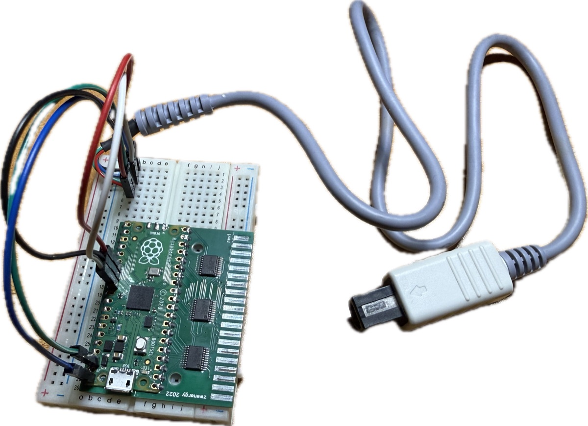
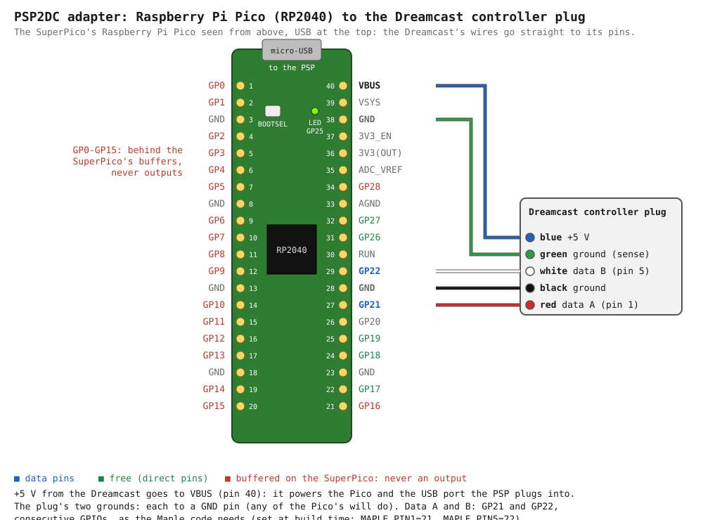

# The prototype adapter: a Pico on a SuperPico

PSP2DC was prototyped on the Raspberry Pi Pico of a
[SuperPico](https://github.com/zwenergy/Superpico), a flash cartridge for the
Watara Supervision handheld built around an ordinary Pico. The adapter to
build is the Waveshare RP2040-Zero described in the [README](../README.md);
this page keeps the prototype's wiring, which still works.

PSP2DC uses only the Pico: the firmware runs on its RP2040, the PSP plugs
into its micro-USB port, and the Dreamcast cable is soldered straight to its
pins. Leave the cartridge out of the Supervision while it is the adapter.

| Dreamcast wire | Colour | Pico pin |
|---|---|---|
| Data A (plug pin 1) | red | GP21, pin 27 |
| Data B (plug pin 5) | white | GP22, pin 29 |
| +5 V | blue | VBUS, pin 40 |
| Ground | black | GND, e.g. pin 28 |
| Sense (ground) | green | GND, e.g. pin 38 |
| *(optional)* debug log | | GP20, pin 26, to a USB-serial adapter's RX, 115200 8N1 |

- **Data A and B:** the Maple code needs two consecutive GPIOs. They are set
  at build time (`MAPLE_PIN1=21`, `MAPLE_PIN5=22`).
- **PSP cable:** a micro-USB OTG adapter and the usual USB-A to Mini-USB
  cable.
- **Firmware:** `scripts/build-firmware.sh superpico`.
- **+5 V to VBUS:** the console's 5 V powers the Pico and, through VBUS, the
  USB port that the PSP plugs into.
- **Flashing:** hold BOOTSEL while plugging the Pico into a computer, then
  copy the `.uf2` file onto the drive that appears. This replaces the
  SuperPico's own firmware; back it up with `picotool` first if you want to
  keep it.

> **Warning:** three 74LVC245 buffers between the cartridge slot and the Pico
> are always on, and they always drive GP0–GP16 and GP28 (red in the
> drawing). Firmware must never set those pins as outputs. Only GP17–GP22,
> GP26, GP27 and the LED (GP25) are free. See section 3.2 of the
> [design notes](psp2dc.md).

The firmware touches nothing else on the cartridge, so a Pico on its own
should work with the same wiring and firmware. That has not been tried.
