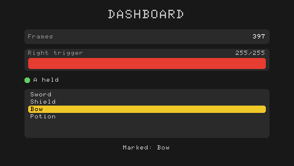
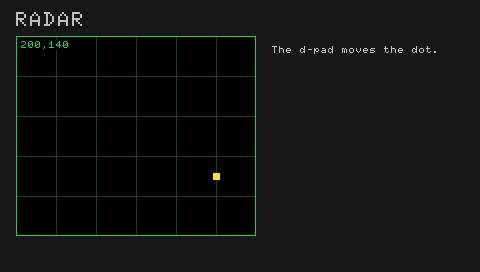
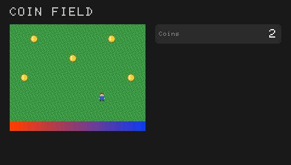
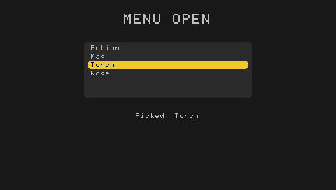

# The libpsp2dc tutorial

Seven small programs, each one file, each adding one idea to the last. Read them in order: the comments explain what is new, why it is done that way, and what to try. Every step builds as a disc image and runs on a Dreamcast with the PSP2DC adapter, or on a computer without any hardware (below).

The library's reference is [../libpsp2dc/README.md](../libpsp2dc/README.md); `psp2dc.h` describes every function.

| Step | You learn | New calls |
|---|---|---|
| [1: hello](step1-hello/main.c) | Finding the adapter; the one call every frame; text on the PSP; what a *session* is | `psp2dc_init` `psp2dc_update` `psp2dc_found` `psp2dc_psp` `psp2dc_clear` `psp2dc_print` `psp2dc_session` |
| [2: buttons](step2-buttons/main.c) | Reading what the PSP sends: its buttons, and what it can do | `psp2dc_poll` `psp2dc_get_caps` |
| [3: dashboard](step3-dashboard/main.c) | Widgets: made once, then only given values | `psp2dc_widget_create` `_set_u32` `_set_text` `_set_range` `_set_colour` `_remove` `psp2dc_notify` |
| [4: drawing](step4-drawing/main.c) | Regions you draw into; drawing only what changes; drawing again after the PSP was away; calls that can fail | `psp2dc_region_create` `psp2dc_draw_rect` `_draw_line` `_draw_text` `psp2dc_region_clip` `psp2dc_present` |
| [5: pictures](step5-pictures/main.c) | Artwork: a palette, sprites, a bitmap; turning a PNG into C | `psp2dc_region_palette` `psp2dc_sprite_create` `psp2dc_sprite_ready` `psp2dc_draw_sprite` `psp2dc_draw_bitmap` |
| [6: input](step6-input/main.c) | A menu on the PSP worked with the PSP's buttons, without pressing the game's controller | `psp2dc_focus` |
| [7: save](step7-save/main.c) | Files on the Memory Stick: operations that run over several frames | `psp2dc_files` `psp2dc_file_write` `_read` `_delete` `_list` `psp2dc_files_free` `psp2dc_file_status` |

After the seven, [`../demo`](../demo/main.c) is a small game that uses steps 1 to 6 together: a maze on the television, and on the PSP its map, a dashboard and a list.

## What the steps look like on the PSP

| 3: dashboard | 4: drawing |
|---|---|
|  |  |
| **5: pictures** | **6: input** |
|  |  |

Steps 1, 2 and 7 show rows of text on the PSP and their results on the television.

## The ideas, in the order they come

1. **Call `psp2dc_update()` once a frame.** Nothing else in the library sends or waits.
2. **The PSP can start over at any time** (unplugged, restarted). `psp2dc_session()` changes when it does. What the library remembers (widgets, regions, palettes, sprites, taken buttons, the files' folder) it sends again by itself; what it does not (text rows, what you drew) you send again.
3. **Calls that queue something can say "not now".** They return 0 when queued. Write drawing as "what is still to be done", try each frame, and note it as done only when the call returned 0.
4. **Send little.** A value that changes is a widget (8 bytes). Something drawn often is a sprite (12 bytes a time). A bitmap is for a picture drawn once.
5. **File operations take several frames.** Start one, then ask each frame how it stands. Buffers you hand over must stay where they are until it ends.

## Building and running

**For a Dreamcast.** `scripts/build-dreamcast.sh` builds every step with KallistiOS (in Docker) as a disc image for GDEMU and the like: `build/tutorial/psp2dc_step1_hello.cdi` and so on. A release's zip has them ready in `dreamcast/tutorial/`. In your own project, each step's `Makefile` shows what it takes: the library's one source file and two include folders.

**On a computer, without a Dreamcast or a PSP.** `scripts/dev/companion-tutorial.sh` runs every step against a simulated adapter and PSP, presses what the step is about, and checks the result (a Mac with the PSP toolchain: it uses the PSP's font). `scripts/dev/flycast-companion.sh` builds the Flycast emulator with the same simulator behind its memory card, so the disc images themselves can be run.

**Leaving a step.** START + A + B + X + Y together goes back to the Dreamcast's menu, as in a commercial game: with GDEMU and openMenu, that is where the next disc is chosen. On the PSP: START, ✕, ○, □ and △.

## Starting your own program from a step

Copy a step's folder, rename the target in its `Makefile`, and keep its three parts: `psp2dc_init()` once, `psp2dc_update()` every frame, and the session check wherever you print or draw. Give your files' folder a name of your own (`psp2dc_files("yourgame")`). The limits to design within (how many widgets, how large the regions, how fast the link) are in [the library's README](../libpsp2dc/README.md#limits).
